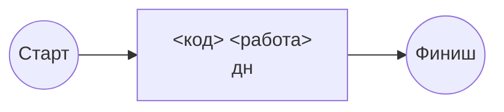

# Календарный план и ресурсы

<!-- TODO: заполните по шагам 3–6 ЛР 3. После утверждения запишите версию и дату. -->

Базовый план, версия <1.0>, утверждён <дата>. Изменения после утверждения — только через запрос на изменение.

## 1. Доступное время

- Период разработки: <дата начала> — <дата окончания>, <N> рабочих дней.
- Нерабочие дни: <праздники>.
- Жёсткие вехи: <защита, сдачи ЛР>.

## 2. Сетевой график



| Работа | Длит., дн | Предшественники | ES | EF | LS | LF | Резерв |
|---|---|---|---|---|---|---|---|
| | | | | | | | |

**Критический путь:** <...>. Длина: <N> рабочих дней.

Выводы и решения: <...>

## 3. Диаграмма Ганта

```mermaid
gantt
    title <Проект>: базовый календарный план
    dateFormat YYYY-MM-DD
    axisFormat %d.%m
    excludes weekends
    section Спринт 1
    <работа> :crit, a, <дата>, <N>d
    Буфер проекта :buf, after a, <N>d
    Защита :milestone, m, <дата>, 0d
```

Буфер: <N> дней. Как рассчитан: <...>

## 4. Ресурсы

Ёмкость на продукт: <ч в неделю> на человека, <ч> за двухнедельный спринт. Отсутствия: <...>

### Матрица загрузки до выравнивания

| Участник | Sprint 1 | Sprint 2 | Sprint 3 | Sprint 4 |
|---|---|---|---|---|
| | | | | |

### Решения по выравниванию

1. <...>

### Матрица загрузки после выравнивания

| Участник | Sprint 1 | Sprint 2 | Sprint 3 | Sprint 4 | Всего |
|---|---|---|---|---|---|
| | | | | | |

## 5. Релизный план

| Спринт | Даты | Цель спринта | Истории (SP) | Пакеты WBS | Релиз |
|---|---|---|---|---|---|
| | | | | | |

Гипотеза скорости: <...> SP за спринт. Что переносим, если скорость не подтвердится: <...>

Roadmap на доске: <ссылка на представление>
