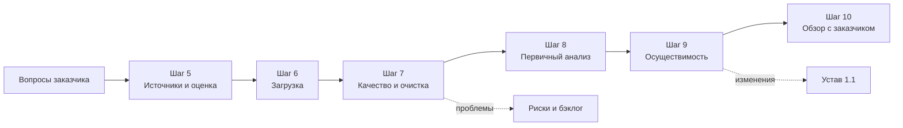
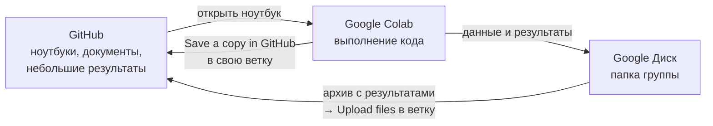

# Лабораторная работа №2
## Требования, содержание проекта и данные: от разговора с заказчиком к бэклогу и первым картам

Вход: одобренный устав проекта и протокол интервью из ЛР 1.
Выход: бэклог продукта, WBS, правила готовности, реестр источников данных, отчёт о качестве данных, первые карты и релиз `v0.2-scope`.

---

## 1. О чём эта работа

В ЛР 1 вы договорились, зачем нужен проект. Теперь нужно ответить на два вопроса: что именно мы делаем и хватит ли нам для этого данных.

Первый вопрос решает управление содержанием. Вы превратите пожелания заказчика в требования и пользовательские истории, решите, что войдёт в первую версию продукта (MVP), и разложите весь объём работ в иерархическую структуру (WBS). Это и есть «базовое содержание» проекта, от которого в ЛР 3 будут считаться сроки и бюджет.

Второй вопрос в геоаналитических проектах часто важнее первого. Красивый бэклог ничего не стоит, если нужных данных нет, они неполные или их нельзя использовать по лицензии. Поэтому до планирования сроков вы найдёте источники, загрузите данные, проверите их качество и сделаете первый пространственный анализ. Это не продукт, а разведка. Её результат может изменить требования, риски и даже границы проекта, и это нормально: лучше узнать об этом сейчас, чем на пятой лабораторной.

**К концу работы вы сможете:**
- выделять функциональные, нефункциональные требования и требования к данным;
- писать пользовательские истории с критериями приёмки и приоритизировать их;
- определять MVP и строить карту историй;
- строить WBS и словарь WBS;
- формулировать Definition of Ready и Definition of Done;
- находить, описывать и оценивать открытые данные, в том числе пространственные;
- проверять качество данных и делать первичный пространственный анализ;
- вести бэклог в GitHub: эпики, истории, подзадачи (sub-issues), поля доски.

---

## 2. Краткая справка

### Требования и содержание

| Термин | Что это простыми словами |
|---|---|
| **Требование** | Утверждение о том, что продукт должен делать или каким он должен быть. Хорошее требование однозначное, проверяемое и имеет источник (кто его высказал). |
| **Функциональное требование** | Что система делает: «показывает на карте ближайшие точки», «строит отчёт по районам». |
| **Нефункциональное требование (NFR)** | Каким продукт должен быть: скорость, удобство, надёжность, безопасность, совместимость. Должно быть измеримым: не «быстро», а «карта открывается быстрее чем за 3 секунды». |
| **Требование к данным** | Каким должны быть данные: полнота, точность, актуальность, формат, лицензия. В геопроектах это отдельная и важная группа. |
| **Эпик** | Крупный блок работы с самостоятельной ценностью, который не помещается в один спринт. Делится на истории. В курсе их шесть (шаг 2.2). |
| **Пользовательская история (User Story)** | Короткое описание требования от лица пользователя: «Как [кто], я хочу [что], чтобы [зачем]». Это не спецификация, а повод для разговора. |
| **Критерии приёмки** | Условия, при которых история считается выполненной. Удобный формат Gherkin: «Дано… Когда… Тогда…». |
| **INVEST** | Проверка качества истории: независимая (Independent), обсуждаемая (Negotiable), ценная (Valuable), оцениваемая (Estimable), небольшая (Small), проверяемая (Testable). |
| **Бэклог продукта** | Упорядоченный список всего, что может понадобиться в продукте. Им управляет владелец продукта. |
| **MoSCoW** | Способ приоритизации: Must (без этого продукта нет), Should (важно, но можно обойтись), Could (хорошо бы), Won't (не в этот раз). Подробно в шаге 2.5. |
| **MVP** | Минимальный набор функций, который уже приносит пользу и позволяет проверить главную гипотезу. |
| **Карта историй (Story Map)** | Таблица, где по горизонтали идут шаги пользователя, а по вертикали истории по приоритету. Горизонтальная линия отсекает MVP. |
| **WBS (иерархическая структура работ)** | Декомпозиция всего объёма проекта на результаты и пакеты работ. Отвечает на вопрос «что нужно получить», а не «что делать по порядку». |
| **Правило 100%** | WBS включает все работы проекта, включая управление, и ничего сверх них. |
| **Пакет работ** | Нижний уровень WBS: результат, который можно оценить, поручить одному ответственному и проверить. Ориентир: от 8 до 80 часов работы. |
| **Словарь WBS** | Таблица с описанием каждого пакета работ: результат, критерий готовности, ответственный, оценка. |
| **Definition of Ready (DoR)** | Условия, при которых задачу можно брать в работу: понятна цель, есть критерии приёмки, известны данные. |
| **Definition of Done (DoD)** | Общие для команды условия, при которых задача считается выполненной: проверено, задокументировано, влито в `main`. |
| **Спайк (spike)** | Короткая исследовательская задача, когда неясно, как что-то сделать. Результат: знание, а не функция. Первичный анализ данных в этой работе по сути и есть спайк. |
| **Базовое содержание (scope baseline)** | Утверждённые требования, бэклог и WBS. Всё, что меняется после утверждения, проходит через управление изменениями (ЛР 5). |

### Данные и пространственный анализ

| Термин | Что это простыми словами |
|---|---|
| **Data discovery** | Поиск и первичная оценка данных до начала разработки. |
| **Метаданные** | Данные о данных: кто автор, когда обновлено, какая лицензия, территория, система координат, описание полей. |
| **Векторные данные** | Объекты в виде точек, линий и полигонов с атрибутами: фонтанчики, дороги, границы районов. Форматы: GeoJSON, GeoPackage (`.gpkg`), Shapefile. |
| **Растровые данные** | Сетка ячеек со значениями: снимки, рельеф, плотность населения. Формат: GeoTIFF. |
| **CRS (система координат)** | Способ привязать данные к Земле. EPSG:4326 (WGS 84) хранит широту и долготу в градусах и подходит для обмена данными. EPSG:3857 используют веб-карты. Для расстояний и площадей нужна проекция в метрах, например зона UTM вашего города (для Екатеринбурга EPSG:32641). |
| **OpenStreetMap (OSM)** | Открытая карта мира, которую наполняют добровольцы. Объекты описываются тегами: `amenity=drinking_water`, `leisure=park`. Полнота сильно зависит от территории. |
| **Overpass API** | Сервис, который отдаёт объекты OSM по запросу. Overpass Turbo — его веб-интерфейс для проверки запросов. |
| **Лицензия данных** | Условия использования. ODbL (OSM): нужно указывать «© участники OpenStreetMap», а производные базы данных публиковать на тех же условиях. CC BY 4.0: нужно указать автора. CC0: ограничений нет. |
| **Профилирование данных** | Систематическая проверка набора: сколько объектов, есть ли пропуски, дубликаты, ошибки геометрии, правильная ли система координат. |
| **Полнота, точность, актуальность** | Все ли объекты есть в данных; насколько верно указаны положение и атрибуты; насколько данные свежие. |
| **Буфер** | Зона вокруг объекта на заданном расстоянии, например 500 м вокруг точки. |
| **Пространственное объединение (spatial join)** | Соединение таблиц не по ключу, а по расположению: «в каком районе находится точка». |
| **Ближайший сосед** | Поиск ближайшего объекта и расстояния до него. |
| **Картограмма (choropleth)** | Карта, где районы закрашены по значению показателя. |

---

## 3. Учебный пример: AquaMap Ekaterinburg (продолжение)

Напомним: департамент благоустройства хочет понять, где горожанам не хватает питьевой воды на улице, и получить веб-карту точек. В ЛР 1 команда AquaMap утвердила устав и сформулировала три аналитических вопроса:
1. Сколько точек питьевой воды в каждом районе и какова их плотность?
2. Какая доля жилых домов находится в пределах 500 м от ближайшей точки?
3. Какие парки остаются без питьевой воды?

В шаблоне репозитория уже лежат ноутбуки, которые отвечают на эти вопросы по данным OpenStreetMap. Это ориентир: ваша задача — повторить логику для своего варианта, со своими вопросами, данными и выводами.

---

## 4. Роли в этой работе

Роли меняются. Менеджером проекта становится тот, кто не был им в ЛР 1.

| Роль | Чем занимается в ЛР 2 |
|---|---|
| Менеджер проекта (новый) | Принимает дела у прежнего, ведёт доску и этап, следит за WBS и сроками, проводит обзор с заказчиком |
| Владелец продукта / аналитик требований | Требования, истории, приоритеты, MVP, общение с заказчиком |
| Аналитик данных | Поиск и оценка источников, реестр, отчёт о качестве |
| Геоаналитик | Загрузка данных, ноутбуки, пространственный анализ, карты |

В группе из 2–3 человек роли совмещаются. Удобные пары: менеджер + владелец продукта, аналитик данных + геоаналитик.

Правила прежние: нет задачи — нет работы, всё в `main` через Pull Request с ревью, использование ИИ записывается в `docs/ai-usage.md`.

---

## 5. Пошаговое задание

### Шаг 0. Подготовка репозитория и передача дел (20–30 минут)

**Обновите репозиторий.** Если ваш репозиторий создан из шаблона до выхода ЛР 2, в нём нет новых файлов. Подтяните их из шаблона:

```bash
git remote add template https://github.com/aydarabdullin/pm-lab-template.git
git fetch template
git switch -c chore/lab2-files
git checkout template/main -- notebooks data requirements.txt .gitignore \
  docs/requirements.md docs/wbs.md docs/definition-of-done.md docs/data-quality.md \
  docs/tasks/lab-2-assignment.md docs/img docs/maps \
  .github/ISSUE_TEMPLATE .github/workflows .github/scripts
git commit -m "chore: add lab 2 files from template"
git push -u origin chore/lab2-files
```

Затем создайте Pull Request и влейте его как обычно. Файлы ЛР 1 (устав, стейкхолдеры) эта команда не затрагивает. Если с Git из терминала сложно, попросите помочь преподавателя или участника группы, который уже это делал.

**Подготовьте трекер.** Откройте **Actions → Bootstrap: метки, этап и стартовые задачи → Run workflow**, выберите **2** и нажмите **Run workflow**. Появятся новые метки (`epic`, `story`, `data`, `analysis`), этап «ЛР2: Требования и данные» и 13 стартовых задач. Укажите в этапе дату сдачи и назначьте исполнителей.

**Передайте дела.** Прежний менеджер за 10 минут рассказывает новому: что на доске, какие задачи открыты, какие условия поставил спонсор на защите ЛР 1. Условия, которые ещё не выполнены, заводятся задачами в этап ЛР 2. Обновите таблицу ролей в README.

---

## Часть А. Требования и содержание проекта

### Шаг 1. Опишите требования (40–50 минут)

Откройте протокол интервью из ЛР 1 и устав. Выпишите всё, что заказчик хочет получить, и разложите на три группы в `docs/requirements.md`.

1. **Функциональные требования** (ровно 5, самые важные для заказчика): что продукт делает. Формулируйте «Система должна…» и указывайте источник: протокол, устав, анализ предметной области.
2. **Нефункциональные требования** (минимум 4): каким продукт должен быть. Каждое должно быть измеримым и проверяемым.
3. **Требования к данным** (минимум 3): какой полноты, точности и свежести должны быть данные, чтобы выводам можно было доверять.
4. **Вне рамок продукта:** чего продукт делать не будет. Сверьте с границами из устава.
5. **Открытые вопросы:** всё, что неясно. Задайте их заказчику на обзоре (шаг 10) или раньше, в переписке.

**Пример (AquaMap).**

| ID | Требование | Источник | Приоритет |
|---|---|---|---|
| FR-01 | Система должна показывать на карте все известные точки питьевой воды города | интервью, 14.10 | Must |
| FR-02 | Система должна показывать ближайшую к пользователю точку и расстояние до неё | интервью | Should |
| FR-03 | Система должна показывать по каждому району число точек и долю жилых домов в пешей доступности | устав, цель 2 | Must |
| FR-04 | Система должна выделять парки без питьевой воды | интервью | Must |
| FR-05 | Система должна выгружать таблицу показателей по районам в CSV | интервью | Could |

| ID | Категория | Требование | Как проверим |
|---|---|---|---|
| NFR-01 | Производительность | Карта открывается быстрее чем за 3 с на мобильном интернете | Lighthouse, режим «Slow 4G» |
| NFR-02 | Совместимость | Карта корректно работает на экране шириной 360 px | Проверка в режиме мобильного устройства в браузере |
| NFR-03 | Правовые | На карте всегда видна подпись «© участники OpenStreetMap» | Визуальная проверка |
| NFR-04 | Воспроизводимость | Весь расчёт повторяется по инструкции за 15 минут на чистом компьютере | Проверка другим участником |

| ID | Требование к данным | Порог | Как проверим |
|---|---|---|---|
| DR-01 | Полнота точек воды | не менее 80% от официального перечня или выборочной проверки | Сравнение с перечнем или выборка на 30 точек |
| DR-02 | Актуальность | данные загружены не раньше чем за 1 месяц до расчёта | `_download_log.json` |
| DR-03 | Тип объекта | учитываются только точки, где воду можно пить на месте | Фильтр по тегам, правило очистки |

Обратите внимание на DR-01: проверить полноту открытых данных без эталона трудно. Сам способ проверки — часть работы, и о нём нужно договориться с заказчиком.

**Результат:** `docs/requirements.md`.

---

### Шаг 2. Эпики, истории, приоритеты и MVP (70–90 минут)

#### 2.1. Что такое эпик и зачем он нужен

Эпик — крупный блок работы, который приносит заказчику самостоятельную ценность и слишком велик, чтобы сделать его за один спринт. Эпик не выполняют напрямую: его делят на пользовательские истории, а историй уже хватает на одну-две недели работы.

Эпики нужны, чтобы бэклог из нескольких десятков историй не превратился в свалку. По эпикам видно, из каких больших частей состоит продукт, как продвигается каждая часть и где отстаём. Поэтому эпиков должно быть немного: в этом курсе их **ровно шесть**, по одному на каждую крупную часть проекта.

#### 2.2. Шесть укрупнённых эпиков

Структура эпиков одинакова для всех вариантов. Так проекты разных групп легко сравнивать, а эпики совпадают с первым уровнем WBS (шаг 3). Название второй части и содержание эпиков вы формулируете под свой вариант.

| № | Эпик | Что в него входит | Основной период | Результат эпика |
|---|---|---|---|---|
| E1 | **Данные** | Поиск источников, загрузка, проверка качества, очистка, инструкция по обновлению | ЛР 2, доработка в ЛР 3–4 | Очищенные слои данных, реестр источников, отчёт о качестве, воспроизводимая загрузка |
| E2 | **Аналитика** | Пространственные расчёты и показатели, которые отвечают на вопросы заказчика | ЛР 2 (первичный анализ), основной объём в ЛР 4–5 | Проверенные расчёты и таблицы показателей с описанием методики |
| E3 | **Пользовательский интерфейс** | Карта, дашборд, бот или другое средство, через которое пользователь работает с продуктом | ЛР 4–5 | Работающий интерфейс, который проходит критерии приёмки историй |
| E4 | **Отчётность** | Материалы для заказчика: выводы и рекомендации, выгрузки, материалы для принятия решения | ЛР 5–6 | Отчёт или дашборд с выводами, на основании которого заказчик может действовать |
| E5 | **Платформа и качество** | Репозиторий и окружение, автопроверки (CI), публикация (GitHub Pages), тестирование | ЛР 2–6, основной объём в ЛР 4 | Опубликованный продукт, который собирается и проверяется автоматически |
| E6 | **Управление проектом** | Устав, планы, риски, статус-отчёты, обзоры с заказчиком, итоговая документация и защита | ЛР 1–6, сквозной | Комплект управленческих документов и принятый заказчиком проект |

Почему эпики «Платформа и качество» и «Управление проектом» тоже в бэклоге: эти работы занимают заметную часть времени команды. Если их не видно в трекере, план всегда получается оптимистичнее реальности.

**Пример названий для AquaMap:**
- `E1. Данные: точки воды, районы, парки и жилая застройка`
- `E2. Аналитика: доступность питьевой воды по районам`
- `E3. Пользовательский интерфейс: веб-карта питьевых точек`
- `E4. Отчётность: рекомендации по размещению новых точек`
- `E5. Платформа и качество: публикация карты и автопроверки`
- `E6. Управление проектом: AquaMap Ekaterinburg`

#### 2.3. Общие требования к эпикам

**Наименование.**
- Формат: `E<номер>. <Название эпика из таблицы>: <чему посвящён в вашем проекте>`. Номера E1–E6 закреплены за эпиками из таблицы, менять их нельзя.
- Вторая часть — существительное, описывающее результат, а не действие: «веб-карта питьевых точек», а не «делаем карту».
- Длина названия — до 70 символов, чтобы оно целиком помещалось на карточке доски.
- Истории внутри эпика получают префикс номера эпика в названии ветки и при обсуждении: история `E2-03` — третья история эпика E2. В заголовке задачи префикс не обязателен.

**Состав.**
- В ЛР 2 пишется **5 пользовательских историй: по одной в каждом эпике E1–E5**. В эпике E6 вместо историй ведутся обычные задачи с меткой `task`.
- Каждая история относится ровно к одному эпику. Если история подходит к двум, значит, её нужно разделить или уточнить.
- В следующих работах эпики пополняются новыми историями. Если в эпике набирается больше 8 историй, это сигнал, что он слишком широк: обсудите с преподавателем, какие истории перенести или объединить.

**Содержание описания эпика.** Описание заполняется по шаблону задачи **Эпик** (New issue → Эпик) и включает:
1. Цель и ценность: зачем эпик нужен заказчику (1–2 предложения).
2. Пользователи: для кого он делается.
3. Границы: что входит и что не входит в эпик.
4. Результат: что конкретно появится в конце (документ, слой данных, экран, отчёт).
5. Критерии готовности эпика: при каких условиях эпик закрывается. Это не сумма критериев историй, а проверка целого: «департамент может по карте выбрать районы для новых точек».
6. Показатель успеха: как поймём, что эпик дал результат (берётся из целей устава).
7. Сроки: этап начала и окончания (Milestone), ориентировочные даты.
8. Связь с WBS и требованиями: коды пакетов WBS и ID требований (FR, NFR, DR).
9. Зависимости и риски: что должно быть готово до начала, ID рисков из реестра.
10. Ответственный: один участник группы, который следит за прогрессом эпика.

**Сроки.**
- Эпик не должен длиться дольше трёх лабораторных работ (кроме сквозных E5 и E6).
- На доске у каждого эпика заполнены поля **Start date** и **Target date** (создайте их как поля типа Date). В ЛР 2 даты ориентировочные, в ЛР 3 они уточняются при календарном планировании и появятся на представлении Roadmap.
- Если эпик сдвигается больше чем на одну лабораторную работу, менеджер проекта фиксирует это в статус-отчёте с причиной.

**Результаты и закрытие.**
- Эпик закрывается, когда закрыты все его подзадачи **и** выполнены критерии готовности эпика.
- Перед закрытием ответственный пишет в эпике короткий итоговый комментарий: что сделано, где лежит результат (ссылки), что перенесено в другие эпики.
- Незавершённые истории не «висят» в закрытом эпике: их переносят в другой эпик или помечают Won't с объяснением.

**Пример описания эпика (AquaMap).**
```markdown
## E2. Аналитика: доступность питьевой воды по районам

**Цель и ценность.** Дать департаменту обоснованную картину того, в каких районах
и парках не хватает питьевой воды, чтобы выбрать места для новых точек.

**Пользователи.** Специалисты департамента благоустройства.

**Входит:** число и плотность точек по районам; доля жилых домов в пределах 500 м;
парки без воды; описание методики расчёта.
**Не входит:** доступность по пешеходной сети (перенесено в Could); прогноз спроса.

**Результат.** Таблица показателей по районам и слой парков без воды
в data/processed/, методика в docs/.

**Критерии готовности эпика.**
- [ ] Показатели рассчитаны для всех районов города
- [ ] Расчёт повторён вторым участником с тем же результатом
- [ ] Методика и ограничения описаны и приняты заказчиком

**Показатель успеха.** Цель 2 устава: 100% районов покрыты расчётом.

**Сроки.** Старт: ЛР 2 · окончание: ЛР 5 · даты уточняются в ЛР 3.

**Связи.** WBS 2.1–2.3 · FR-03, FR-04 · DR-01, DR-03 · риски R1.

**Зависимости.** Очищенные слои из E1.

**Ответственный.** @oleg-k

## Истории
(список sub-issues появится ниже автоматически)
```

#### 2.4. Пользовательские истории

Напишите **5 историй**, по одной на каждый эпик E1–E5, через шаблон задачи **Пользовательская история**. Формат: «Как [кто], я хочу [что], чтобы [зачем]». Каждой истории нужны критерии приёмки и приоритет. Выбирайте для каждого эпика самую важную историю: ту, без которой эпик теряет смысл.

**Пять историй AquaMap.**

| ID | Эпик | История | Приоритет |
|---|---|---|---|
| US-1 | E1. Данные | Как аналитик департамента, я хочу обновлять данные о точках по инструкции за 15 минут, чтобы карта не устаревала | Should |
| US-2 | E2. Аналитика | Как специалист департамента, я хочу видеть районы, закрашенные по доле домов без питьевой воды в пешей доступности, чтобы выбрать районы для новых точек | Must |
| US-3 | E3. Интерфейс | Как житель, я хочу видеть на карте все точки питьевой воды, чтобы найти ближайшую | Must |
| US-4 | E4. Отчётность | Как специалист департамента, я хочу получить список парков без питьевой воды с их площадью, чтобы включить их в план установки | Must |
| US-5 | E5. Платформа и качество | Как специалист департамента, я хочу открывать карту по ссылке в браузере без установки программ, чтобы показать её коллегам | Should |

Ниже история US-2 расписана полностью.

Проверьте каждую историю по INVEST. Историю, которую нельзя проверить или которая занимает больше спринта, перепишите или разделите.

**Пример истории US-2 (эпик E2).**
```markdown
## История
**Как** специалист департамента благоустройства, **я хочу** видеть на карте районы,
закрашенные по доле домов без питьевой воды в пешей доступности,
**чтобы** выбрать районы для установки новых точек в следующем году.

## Критерии приёмки
Сценарий: просмотр доступности по районам
  Дано открытая карта AquaMap
  Когда я включаю слой «Доступность по районам»
  Тогда каждый район закрашен по доле домов дальше 500 м от точки воды
  И при наведении на район я вижу его название, число точек и долю домов в доступности

Сценарий: подпись источника данных
  Дано открытая карта
  Тогда в углу карты видна подпись «© участники OpenStreetMap» и дата загрузки данных

## Приоритет
Must

## Эпик
#15 (E2. Аналитика: доступность питьевой воды по районам)
```

**Привяжите истории к эпикам.** Откройте эпик и внизу, в блоке **Sub-issues**, нажмите **Add sub-issue → Add existing issue**, затем выберите историю. В эпике появятся список историй и полоса прогресса.

#### 2.5. Приоритизация по MoSCoW

**Что это.** MoSCoW — способ договориться с заказчиком о приоритетах, когда всё сделать не успеть. Название составлено из первых букв четырёх категорий (буквы «o» добавлены для удобства произношения).

| Категория | Смысл | Как проверить | Пример (AquaMap) |
|---|---|---|---|
| **Must have** — обязательно | Без этого продукт не решает задачу или проект проваливает цель устава | «Если этого не будет, заказчик откажется принимать продукт?» Да → Must | Картограмма доступности по районам |
| **Should have** — важно | Существенно повышает ценность, но есть обходной путь | «Можно ли временно обойтись другим способом?» Да → Should | Показ ближайшей точки пользователю |
| **Could have** — желательно | Приятное дополнение, делаем, если останется время | «Заметит ли заказчик отсутствие?» Скорее нет → Could | Выгрузка таблицы в CSV |
| **Won't have (this time)** — не в этот раз | Осознанно исключено из текущего проекта | Записываем, чтобы не возвращаться к спору | Маршрут до точки, мобильное приложение |

**Правила.**
- На Must приходится не больше 60% общего объёма работ (в примере AquaMap 3 истории из 5). Остальное — запас на случай, если что-то пойдёт не так: в первую очередь жертвуют Could, затем Should.
- Won't — не мусорная корзина, а полноценное решение. Истории Won't остаются в бэклоге с пояснением, почему их отложили.
- Приоритет ставит владелец продукта вместе с заказчиком, а не разработчик. Спорные случаи выносятся на обзор (шаг 10).
- Приоритет можно пересматривать, но только открыто: изменение записывается в комментарии к истории.

#### 2.6. Карта историй и MVP

Постройте карту историй: по горизонтали шаги пользователя, по вертикали истории по убыванию приоритета. Горизонтальная линия отделяет MVP. Обычно в MVP попадают истории Must, но это не автоматическое правило: в MVP должен войти минимальный «сквозной» путь пользователя от начала до результата.

**Пример карты историй (фрагмент).**

| | Найти точку | Оценить район | Спланировать новые точки | Поделиться результатом | Поддерживать актуальность |
|---|---|---|---|---|---|
| **MVP** | US-3. Все точки на карте (Must) | US-2. Картограмма по районам (Must) | US-4. Список парков без воды (Must) | US-5. Карта по ссылке (Should) | |
| **Следующие версии** | | | | | US-1. Обновление данных по инструкции (Should) |

Граница MVP: в первую версию входит сквозной путь департамента от «увидеть точки» до «показать коллегам план». Поэтому US-5 входит в MVP, хотя её приоритет Should: без неё результат нельзя передать. А US-1 оставлена на следующую версию: для первого решения достаточно разовой загрузки данных. Объясните свою границу MVP в двух-трёх предложениях: какую главную гипотезу проверяет первая версия.

#### 2.7. Настройка доски

Добавьте в Project поля:
- `MoSCoW` (Single select: Must, Should, Could, Won't);
- `Start date` и `Target date` (Date) для эпиков;
- поле `Estimate` пока оставьте пустым, оценивать будем в ЛР 3.

Создайте представление **«Бэклог»**: таблица, сгруппированная по родительской задаче (**Group by → Parent issue**), чтобы истории были видны под своими эпиками. Создайте второе представление **«Эпики»**: таблица с фильтром `label:epic` и столбцами `Start date`, `Target date`, `Assignees`, прогресс подзадач (поле **Sub-issues progress**).

**Результат шага 2:** шесть эпиков с заполненным описанием, 5 историй (по одной в эпиках E1–E5), привязанных к эпикам, приоритеты MoSCoW, карта историй и обоснование MVP в `docs/requirements.md`, представления «Бэклог» и «Эпики» на доске.

---

### Шаг 3. Постройте WBS (40–50 минут)

#### Что такое WBS

WBS (Work Breakdown Structure, иерархическая структура работ) — это дерево, которое раскладывает весь объём проекта на всё более мелкие части, пока каждую часть нельзя будет оценить, поручить одному человеку и проверить. Нижний уровень дерева называется **пакетом работ**.

WBS отвечает на вопрос **«что нужно получить»**, а не «что и в каком порядке делать». Поэтому узлы WBS называют существительными-результатами: «реестр источников», «очищенные слои», «картограмма районов». Порядок, длительность и зависимости появятся позже, в календарном плане ЛР 3, и будут строиться именно из пакетов WBS.

**Чем WBS отличается от бэклога.** Бэклог описывает продукт с точки зрения пользователя и постоянно меняется. WBS описывает весь проект, включая работы, которые пользователь никогда не увидит: управление, подготовку данных, инфраструктуру, документацию, защиту. В нашем курсе первый уровень WBS совпадает с шестью эпиками, поэтому каждую историю легко найти в WBS, а каждый пакет WBS — в трекере.

**Главные правила.**
- **Правило 100%.** WBS включает все работы проекта и ничего сверх них. Сумма дочерних узлов равна родителю: ничего не потеряно и ничего не добавлено.
- **Без пересечений.** Одна работа находится только в одном узле.
- **Размер пакета.** Ориентир от 8 до 80 часов работы. Меньше — слишком мелко для WBS (это уже задача в трекере), больше — пакет нельзя проконтролировать, его нужно разделить.
- **Один ответственный** за каждый пакет.
- **Проверяемый результат** у каждого пакета.

#### Что сделать

1. Постройте WBS на 3 уровня в `docs/wbs.md` в виде диаграммы Mermaid. Первый уровень — шесть веток по эпикам E1–E6.
2. Заполните словарь WBS для каждого пакета работ: результат, критерий готовности, ответственный, ориентировочная оценка в часах, связанные эпики и задачи.
3. Проверьте правило 100%: у каждой истории MVP должно быть место в WBS, а в WBS не должно быть работ, которые никому не нужны.

**Пример (AquaMap, фрагмент).**

```mermaid
flowchart TD
    P[0. AquaMap Ekaterinburg]
    P --> D[1. Данные · E1]
    P --> A[2. Аналитика · E2]
    P --> U[3. Пользовательский интерфейс · E3]
    P --> R[4. Отчётность · E4]
    P --> Q[5. Платформа и качество · E5]
    P --> M[6. Управление проектом · E6]
    D --> D1[1.1 Реестр источников]
    D --> D2[1.2 Сырые данные и инструкция загрузки]
    D --> D3[1.3 Отчёт о качестве]
    D --> D4[1.4 Очищенные слои]
    A --> A1[2.1 Показатели по районам]
    A --> A2[2.2 Доступность 500 м]
    A --> A3[2.3 Парки без воды]
    U --> U1[3.1 Слой точек]
    U --> U2[3.2 Картограмма районов]
    R --> R1[4.1 Рекомендации по размещению]
    R --> R2[4.2 Выгрузки для департамента]
    Q --> Q1[5.1 Окружение и автопроверки]
    Q --> Q2[5.2 Публикация на GitHub Pages]
    M --> M1[6.1 Устав и планы]
    M --> M2[6.2 Статус-отчёты и обзоры]
    M --> M3[6.3 Итоговый отчёт и защита]
```


| Код | Пакет работ | Результат | Критерий готовности | Ответственный | Оценка, ч | Эпик / Issues |
|---|---|---|---|---|---|---|
| 1.1 | Реестр источников | `data/sources.md` | 3 источника, все поля заполнены, оценка по шкале 1–5 | Анна | 8 | E1, #22 |
| 1.3 | Отчёт о качестве | `docs/data-quality.md` | Профиль по всем слоям, проблемы заведены задачами | Анна | 10 | E1, #24 |
| 2.2 | Доступность 500 м | Таблица по районам и карта | Расчёт в метрах, проверен вторым участником | Олег | 12 | E2, #25, #31 |

**Результат:** `docs/wbs.md`.

---

### Шаг 4. Договоритесь о готовности: DoR и DoD (20–30 минут)

#### Что это и зачем

Самые частые споры в команде звучат так: «Я не могу начать, мне непонятно, что делать» и «Это уже готово? — Ну почти». Две договорённости снимают эти споры заранее.

**Definition of Ready (DoR), критерии готовности к работе** — список условий, при которых задачу можно брать в работу (в спринт). Если условия не выполнены, задача остаётся в бэклоге и дорабатывается: уточняются цель, критерии приёмки, данные. DoR защищает исполнителя от задач вида «сделай что-нибудь с картой».

**Definition of Done (DoD), критерии завершённости** — список условий, при которых любая задача считается выполненной. DoD одна на всю команду и одинакова для всех задач своего типа. DoD защищает заказчика и команду от «почти готово»: задача либо выполнена полностью, либо не выполнена.

**Чем DoD отличается от критериев приёмки.** Критерии приёмки свои у каждой истории и описывают, что именно должна делать функция. DoD общий для всех и описывает качество выполнения: проверено, задокументировано, влито в `main`. История готова, когда выполнены и её критерии приёмки, и DoD.

**Правила формулировки.**
- Каждый пункт проверяется ответом «да» или «нет». «Код хорошего качества» — плохой пункт, «PR одобрен другим участником» — хороший.
- Пунктов немного: 4–7 в DoR, 5–10 в DoD. Длинный список никто не проверяет.
- Только то, что команда реально может выполнить на каждой задаче.
- DoD пересматривается на ретроспективах: если проблема повторяется, правило добавляется.
- В нашем курсе DoD копируется в чек-лист шаблона Pull Request, чтобы проверка шла автоматически при каждом ревью.

#### Что сделать

Заполните `docs/definition-of-done.md` и добавьте пункты DoD в чек-лист `.github/pull_request_template.md`.

**Пример (AquaMap).**

Definition of Ready. Задачу можно брать в работу, если:
- у неё есть понятная цель и критерии приёмки;
- она привязана к эпику, у неё есть приоритет MoSCoW;
- известно, какие данные нужны и где они лежат;
- задача помещается в один спринт (оценка появится в ЛР 3);
- зависимости сняты или известно, когда они будут сняты.

Definition of Done. Задача выполнена, если:
- выполнены все критерии приёмки;
- изменения влиты в `main` через PR с одобрением другого участника;
- автопроверки в PR прошли без ошибок;
- обновлена документация, если поведение изменилось;
- для задач с данными: источник и дата загрузки записаны в реестре, сырые данные не попали в Git, расчёт выполнен в метрической системе координат, ноутбук запускается сверху вниз без ошибок;
- для карт: есть подпись источника данных и легенда.

**Результат:** `docs/definition-of-done.md` и обновлённый шаблон PR.

---

## Часть Б. Данные и первичный анализ

В этой части вы проходите путь, который в реальных data-проектах называют **разведкой данных**: от вопроса заказчика к источникам, от источников к проверенным данным, от данных к первым ответам и решению о том, можно ли продолжать проект.

Каждый шаг устроен одинаково. Сначала коротко сказано, **что сделать**. Затем подробно показано, **как это сделала команда AquaMap**: какие решения принимала, почему и что получилось. Повторяйте логику, а не цифры: у вашего варианта будут свои данные и свои проблемы.



---

### Шаг 5. Найдите и оцените источники данных (50–70 минут)

#### Что сделать

1. **Начните с вопросов, а не с данных.** В `data/sources.md`, в таблице «Какие данные нужны», для каждого аналитического вопроса из устава запишите, какие объекты, атрибуты, территория и период нужны.
2. **Найдите не менее 3 источников**, из них не менее 2 пространственных. Где искать:
   - OpenStreetMap: теги ищите на [OSM Wiki](https://wiki.openstreetmap.org/wiki/Map_features), наличие объектов на своей территории проверяйте в [Overpass Turbo](https://overpass-turbo.eu);
   - региональные и национальные порталы открытых данных, сайты администраций и ведомств;
   - статистика: численность населения по районам, социально-экономические показатели;
   - глобальные открытые наборы: WorldPop (население), Copernicus (спутниковые данные), Natural Earth, GADM (границы);
   - тематические открытые базы по вашему варианту: качество воздуха, транспорт, зарядные станции.
3. **Заполните карточку** на каждый источник по шаблону в `data/sources.md`. Лицензию проверяйте на официальном сайте источника: без понятных условий использования источник брать нельзя.
4. **Оцените каждый источник по шкале от 1 до 5** по шести критериям (таблица ниже). Итоговая оценка — среднее арифметическое, округлённое до десятых.
5. **Примите решение** по каждому источнику. Источники, от которых вы отказались, тоже оставьте в реестре: это показывает, что выбор был осознанным.

#### Шкала оценки источников

| Критерий | 1 — плохо | 3 — приемлемо | 5 — отлично |
|---|---|---|---|
| **Релевантность** | Почти не помогает ответить на вопрос | Помогает частично или косвенно | Прямо отвечает на вопрос |
| **Полнота и покрытие** | Покрывает малую часть территории или объектов | Заметные пробелы | Покрывает всю территорию, пробелов не видно |
| **Актуальность** | Старше 5 лет или дата неизвестна | 1–5 лет | Моложе года или постоянно обновляется |
| **Качество и документация** | Нет описания полей и методики | Описание неполное | Есть описание полей, методики и метаданные |
| **Доступность и простота обработки** | Только по запросу, платно или нужна сложная конвертация | Ручное скачивание и подготовка | API или прямая ссылка, формат готов к работе |
| **Лицензия** | Неизвестна или запрещает наше использование | Есть ограничения или условия неясны | Открытая лицензия с понятными условиями |

Оценки 2 и 4 ставьте, когда источник находится между описанными уровнями.

**Правила решения:**

| Итоговая оценка | Решение |
|---|---|
| 3,5 и выше | Использовать |
| от 2,5 до 3,4 | Использовать с оговорками: оговорки записываются в карточку и в риски |
| ниже 2,5 | Отказаться или искать замену |
| Лицензия = 1 | **Отказаться независимо от среднего.** Хорошие данные, которыми нельзя пользоваться, для проекта бесполезны |

Высокая оценка источника не означает, что он обязательно нужен в MVP. Оценка отвечает на вопрос «можно ли доверять и пользоваться», а приоритет — «нужно ли это сейчас».

#### Как это сделала команда AquaMap

**1. Таблица потребностей.** Аналитик данных Анна выписала три вопроса из устава и для каждого определила нужные данные:

| Вопрос | Какие данные нужны | Источники |
|---|---|---|
| 1. Сколько точек в каждом районе и какова плотность? | Точки питьевой воды; границы районов; численность населения районов (чтобы считать точки на 10 тыс. жителей) | DS-01, DS-02 |
| 2. Какая доля жилых домов ближе 500 м к точке? | Точки; жилые здания; в идеале распределение жителей по территории | DS-01, DS-03 |
| 3. Какие парки остаются без воды? | Точки; границы парков | DS-01 |

Уже на этом этапе видно, что почти всё держится на одном источнике, OpenStreetMap. Это удобно, но рискованно: если в OSM данные неполные, страдают все три ответа. Анна сразу записала это как риск (см. шаг 9).

**2. Поиск.** Команда потратила около часа и проверила пять мест:
- **OSM Wiki.** Нашли теги: `amenity=drinking_water` (питьевой фонтанчик или кран), `amenity=water_point` (точка набора воды), `man_made=water_tap` (водоразборный кран). Тут же выяснилось, что `man_made=water_well` означает колодец или скважину. Это пригодилось на шаге 7.
- **Overpass Turbo.** Запрос по городу показал около двухсот объектов. Этого достаточно, чтобы продолжать.
- **Сайт администрации города и статистика.** Нашли численность населения по районам на 1 января. Данных в виде готового файла нет: цифры приводятся в публикациях, их пришлось собрать в таблицу вручную.
- **WorldPop.** Нашли растр численности населения с разрешением 100 м по России.
- **Официальный перечень питьевых фонтанчиков** от городских служб в открытом доступе найти не удалось. Это важная находка: без эталона полноту OSM напрямую не проверить. Команда записала открытый вопрос к заказчику: «Есть ли у департамента собственный перечень точек?»
- **Коммерческий онлайн-справочник организаций** тоже содержит точки воды, но его условия использования, как и у большинства коммерческих картографических сервисов, не разрешают извлекать данные и публиковать их повторно. Команда занесла его в реестр как отклонённый.

**3. Оценка.**

| ID | Источник | Релев. | Полнота | Актуальн. | Качество | Доступн. | Лицензия | Итог | Решение |
|---|---|---|---|---|---|---|---|---|---|
| DS-01 | OpenStreetMap: точки воды, районы, парки, жилые здания | 5 | 3 | 5 | 3 | 5 | 5 | **4,3** | Использовать |
| DS-02 | Численность населения по районам (администрация города, статистика) | 4 | 4 | 4 | 3 | 2 | 3 | **3,3** | С оговорками |
| DS-03 | WorldPop, растр населения 100 м | 3 | 5 | 3 | 4 | 4 | 5 | **4,0** | Использовать, но не в MVP |
| DS-04 | Коммерческий онлайн-справочник | 4 | 4 | 5 | 4 | 2 | 1 | 3,3 | **Отказаться**: лицензия = 1 |

Как команда рассуждала:
- **DS-01, полнота 3.** Объекты есть по всему городу, но доля нанесённых на карту реальных фонтанчиков неизвестна. Ставить 5 без проверки было бы самообманом.
- **DS-01, качество 3.** Теги описаны на OSM Wiki, но каждый участник OSM ставит их по-своему. Нет гарантии, что `drinking_water` — именно питьевой фонтанчик.
- **DS-02, доступность 2.** Цифры нужно вручную переносить из публикаций.
- **DS-02, лицензия 3.** Это официальная публикация, ссылаться на неё можно, но явной открытой лицензии нет. Команда решила использовать цифры со ссылкой на источник и записала это в оговорки.
- **DS-02, качество 3.** Публикуется численность **зарегистрированного** населения, а не фактически проживающего. Для расчёта на 10 тыс. жителей это допустимо, но в выводах нужно указать, какая численность использована.
- **DS-03, релевантность 3.** Это модельная оценка, а не перепись. Она полезна, чтобы считать жителей, а не дома (вопрос 2), но в MVP достаточно домов. Источник оставили для расширенного анализа (история с приоритетом Could).
- **DS-04.** Среднее 3,3 формально дало бы «с оговорками», но сработало стоп-правило по лицензии.

**4. Карточка источника.** Полная карточка DS-01 в реестре:

| Поле | Значение |
|---|---|
| ID | DS-01 |
| Название | OpenStreetMap |
| Ссылка | https://www.openstreetmap.org, загрузка через Overpass API (библиотека osmnx) |
| Для каких вопросов | 1, 2, 3 |
| Слои | Точки воды, границы районов, парки, жилые здания |
| Тип / формат | Вектор: точки и полигоны; после загрузки GeoPackage |
| Лицензия | ODbL 1.0, подпись «© участники OpenStreetMap» |
| CRS | EPSG:4326 |
| Охват / актуальность | Город целиком, на день загрузки |
| Число объектов | около 220 точек воды, 8 районов, около 300 парков, около 17 тыс. жилых зданий |
| Ограничения | Полнота неизвестна; часть точек — колодцы; у многих зданий не указан тип |
| Оценка | 5 / 3 / 5 / 3 / 5 / 5 = **4,3** |
| Решение | Использовать. Полноту проверить выборочно, правила фильтрации согласовать с заказчиком |

**Результат шага:** `data/sources.md` с таблицей потребностей, сводной таблицей и карточками.

---

### Шаг 6. Загрузите данные (40–60 минут)

#### Что сделать

Ноутбуки курса рассчитаны на **Google Colab**: это бесплатная среда Google, которая работает в браузере, ничего устанавливать не нужно. Как получить доступ и связать Colab с репозиторием и Google Диском, подробно описано в приложении Б. Тем, кто предпочитает работать на своём компьютере, подойдёт локальная установка из `notebooks/README.md`: ноутбуки работают в обоих вариантах без изменений.

1. **Подготовьте Colab** по приложению Б, шаги 1–4: аккаунт Google, общая папка группы на Google Диске, открытие ноутбука из GitHub.
2. **Адаптируйте ноутбук** `notebooks/01_data_collection.ipynb`: в первой ячейке кода поменяйте территорию (`PLACE`) и набор слоёв с тегами (`LAYERS`).
3. **Запустите ноутбук.** Впишите имя папки группы в `PROJECT_FOLDER` и выберите **Среда выполнения → Выполнить все**. Данные сохранятся в папку `data/raw` на Google Диске группы, дата загрузки — в `data/raw/_download_log.json`. Изменённый ноутбук сохраните в свою ветку через **Файл → Сохранить копию на GitHub** (приложение Б, шаг 5).
4. **Источники не из OSM** скачайте вручную в `data/raw` на Диске. Небольшие таблицы, которые вы собрали руками из публикаций, положите в `data/manual/` репозитория и скопируйте в `data/manual` на Диске: в Git их хранить можно, потому что повторить ручной сбор сложнее, чем скачать файл.
5. **Опишите воспроизведение** в `data/README.md`. Проверка: другой участник создаёт у себя на Диске пустую тестовую папку, указывает её в `PROJECT_FOLDER` и восстанавливает данные только по инструкции.

Сырые данные остаются на Диске и в Git не попадают: при локальной работе это уже настроено в `.gitignore`. Если сервер Overpass перегружен, подождите несколько минут и запустите ячейку снова. Запасные способы описаны в конце ноутбука.

#### Как это сделала команда AquaMap

**1. Параметры.** Геоаналитик Олег оставил настройки ноутбука почти без изменений: учебный пример написан как раз для AquaMap. В первой ячейке:
```python
PLACE = "Екатеринбург, Россия"
DISTRICT_ADMIN_LEVEL = "9"      # районы города в OSM
LAYERS = {
    "water_points": {"amenity": ["drinking_water", "water_point"], "man_made": "water_tap"},
    "parks":        {"leisure": "park"},
    "residential":  {"building": ["apartments", "residential", "house", "detached", "dormitory"]},
}
```
Для вашего варианта это главное место изменений. Например, для варианта с зарядными станциями слой будет `{"amenity": "charging_station"}`, а для варианта со школами — `{"amenity": "school"}`.

Почему уровень районов 9: в OSM у административных границ есть уровень `admin_level`. В городах России районы обычно отмечены уровнем 9, но это стоит проверить в Overpass Turbo для своего города.

**2. Запуск.** Загрузка заняла несколько минут, большую часть времени заняли жилые здания. В `_download_log.json` записались дата, источник, лицензия и число объектов в каждом слое. Эти цифры Анна перенесла в карточку DS-01.

**3. Ручные данные.** Численность населения по районам Анна собрала в таблицу `data/manual/population_by_district.csv`:
```csv
district,population,year,source
Академический район,<число>,2025,<ссылка на публикацию>
Ленинский район,<число>,2025,<ссылка на публикацию>
...
```
Названия районов она записала точно так же, как в слое районов из OSM, иначе таблицы не соединятся. Для каждой строки указан год и ссылка: если через месяц кто-то спросит, откуда цифра, ответ будет в самой таблице.

**4. Инструкция.** Олег создал на Google Диске папку `pm-lab-00-aquamap` и открыл к ней доступ группе, остальные добавили ярлык в «Мой диск». В `data/README.md` команда записала три шага: получить доступ к папке группы, открыть ноутбук 01 в Colab, указать папку и выполнить все ячейки. Затем Иван, который в загрузке не участвовал, создал на своём Диске пустую папку `aquamap-test`, указал её в `PROJECT_FOLDER` и запустил ноутбук 01 по инструкции. Слои OSM загрузились, но ноутбук 03 потом не нашёл таблицу населения: в инструкции не было сказано, что `data/manual/population_by_district.csv` нужно скопировать из репозитория в папку на Диске. Строку добавили. Так и работает проверка воспроизводимости: её проводит человек, который не делал работу сам.

**Результат шага:** данные в папке группы на Google Диске (`data/raw`, `data/manual`), таблицы ручного сбора в `data/manual/` репозитория, адаптированный ноутбук 01 в репозитории, заполненный `data/README.md`, обновлённые карточки (дата загрузки, число объектов).

---

### Шаг 7. Проверьте качество данных (60 минут)

#### Что сделать

1. **Запустите** `notebooks/02_data_profiling.ipynb`. Он строит сводный профиль слоёв.
2. **Найдите не менее 3 проблем.** Каждую заведите задачей по шаблону **Проблема с данными** (метка `data`).
3. **Решите, что делать с каждой проблемой:** очистить, дополнить, заменить источник, согласовать с заказчиком или принять как ограничение и указать его в выводах.
4. **Опишите правила очистки** в ноутбуке и в отчёте. Каждое правило меняет результат, поэтому спорные правила согласуйте с заказчиком.
5. **Сверьтесь с требованиями к данным** из шага 1: выполняются ли пороги.
6. **Заполните** `docs/data-quality.md`.

#### Как читать профиль

| Столбец профиля | Что означает | На что смотреть |
|---|---|---|
| объектов | Сколько записей в слое | Сравните с ожиданием: 5 точек на город-миллионник — повод насторожиться |
| CRS | Система координат | Должна быть задана. Если пусто — расчёты будут неверными |
| типы геометрии | Точки, линии, полигоны | Слой точек может содержать полигоны (например, фонтан нарисован контуром) |
| пустых / некорректных геометрий | Объекты без формы или с самопересечениями | Некорректные полигоны ломают пространственные операции |
| дубликатов по id | Один объект OSM загружен дважды | Обычно 0; если нет, удалить |
| вне территории | Объекты за границей города | Допустимы на краю; много — ошибка в запросе |
| заполненность атрибутов | Доля непустых значений | Важный для продукта атрибут с низкой заполненностью — повод пересмотреть требования |

#### Как это сделала команда AquaMap

Ниже — настоящие результаты проверки ноутбука на данных OSM по Екатеринбургу. Ваши цифры будут другими.

**1. Первое впечатление.** Профиль показал 223 точки воды, все с заданной системой координат, без пустых и некорректных геометрий и без дубликатов по идентификатору. С технической стороны данные чистые. Но техническая чистота — ещё не качество: главные проблемы нашлись в смысле данных.

**2. Найденные проблемы.**

**Проблема 1. Часть «питьевых точек» — колодцы и скважины.** Таблица сочетаний тегов показала, что 36 из 223 объектов отмечены одновременно как `amenity=drinking_water` и `man_made=water_well`. Олег открыл несколько таких объектов на карте: это колодцы в частном секторе, а не уличные фонтанчики. Для задачи департамента (точки в общественных местах) они не подходят. Но решение «исключить» влияет на результат: без них покрытие окраинных районов падает. Поэтому менеджер Иван написал заказчику и получил подтверждение: колодцы исключаем. Правило записано в ноутбуке (`EXCLUDE_MAN_MADE = ["water_well"]`) и в отчёте, со ссылкой на письмо.

**Проблема 2. У большинства точек нет названия и признака питьевой воды.** Название (`name`) заполнено у 45% точек, признак `drinking_water=yes` — у 17%. Команда сверилась с требованиями: название на карте не обязательно (FR-01 требует только показывать точку). Решение: принять как ограничение. Но в истории US-3 пришлось поправить критерий приёмки: во всплывающей подсказке показывается название точки, «если оно есть», а не всегда.

**Проблема 3. Возможные дубликаты.** Две точки стоят ближе 5 м от соседней. Это может быть ошибкой (одну точку нанесли дважды) или реальностью (два крана рядом). Автоматически это не решить. Задача: проверить вручную по спутниковому снимку. Она маленькая, и её взяли сразу.

**Проблема 4. Жилые дома учтены не все.** В слое около 17 тыс. жилых зданий. Олег сравнил это с общим числом зданий в OSM по городу и понял, что у многих зданий тип не указан: стоит просто `building=yes`. Такие здания не попали в выборку жилых, и знаменатель в вопросе 2 занижен. Насколько сильно, сейчас неизвестно. Это не исправить очисткой: это ограничение источника. Решение: записать как риск (R5) и завести историю в эпике E1 «уточнить жилую застройку» для ЛР 3–4.

**3. Требования к данным.**

| Требование | Порог | Факт | Выполнено? |
|---|---|---|---|
| DR-01 Полнота точек | не менее 80% | Неизвестно: нет эталона. Ждём ответа заказчика о перечне | Не проверено |
| DR-02 Актуальность | не старше 1 месяца | Загружено сегодня | Да |
| DR-03 Тип объекта | только питьевые точки | После исключения колодцев — да | Да |

Честная строка «не проверено» лучше, чем придуманная цифра. Она превращается в задачу и вопрос к заказчику.

**4. Итог очистки.** В `data/processed/` легли очищенные слои: 180 точек воды вместо 223 (исключены колодцы и объекты вне границы), районы, парки, жилые здания.

**Обратите внимание.** Три из четырёх проблем повлияли не только на данные, но и на управление проектом: одна потребовала решения заказчика, другая изменила приоритет истории, третья стала риском и новой историей. Именно этого ждёт преподаватель: данные — не отдельный технический блок, а источник управленческих решений.

**Результат шага:** профиль в ноутбуке, не менее 3 задач по проблемам данных, очищенные слои в `data/processed/` (в Colab переносятся в репозиторий архивом из последней ячейки ноутбука 02), `docs/data-quality.md`.

---

### Шаг 8. Сделайте первичный пространственный анализ (60–80 минут)

#### Что сделать

1. **Возьмите минимум 2 аналитических вопроса** из устава и ответьте на них в `notebooks/03_spatial_analysis.ipynb`. Замените операции примера теми, что нужны вашему варианту.
2. **Все расстояния и площади считайте в метрической проекции.** В ноутбуке она подбирается автоматически функцией `estimate_utm_crs()`. Буфер «500» в EPSG:4326 означает 500 градусов, а не метров: это самая частая ошибка.
3. **Постройте две карты:** статичную для отчёта (`docs/img/`) и интерактивную для заказчика (`docs/maps/`). На обеих — подпись источника данных.
4. **Запишите выводы** в последней ячейке ноутбука: ответ с цифрами, ограничения данных, что это значит для продукта и для рисков.

#### Как это сделала команда AquaMap

**Подготовка.** Все слои переведены в проекцию UTM зоны 41N (EPSG:32641), в которой лежит Екатеринбург. Жилые здания заменены точками внутри контура (`representative_point`): для расчёта расстояния до ближайшей точки воды форма здания не важна. Тестовый прогон делался на выгрузке, обрезанной прямоугольником, поэтому один район (Верх-Исетский) в результаты не попал. Цифры ниже условные.

**Вопрос 1. Сколько точек в каждом районе и какова их плотность?**
Метод: пространственное объединение «точка внутри района» (`sjoin`, условие `within`), затем подсчёт по районам и деление на площадь.
Результат: от 0,4 точки на 10 км² в Железнодорожном районе до 12 в Ленинском. Если в `data/manual/` есть таблица населения, ноутбук дополнительно считает точки на 10 тыс. жителей. Этот показатель понятнее заказчику: районы сильно различаются по площади, и плотность на квадратный километр в больших окраинных районах всегда низкая.

**Вопрос 2. Какая доля жилых домов ближе 500 м к точке?**
Метод: для каждого дома ищется ближайшая точка воды (`sjoin_nearest`) и расстояние до неё. Дом считается «в доступности», если расстояние не больше 500 м. Порог 500 м взят из требований: это примерно 6–7 минут пешком. Это расстояние по прямой, реальный путь по улицам длиннее. Команда записала это как ограничение, а расчёт по пешеходной сети — как возможную историю Could.
Результат: по городу около 40% учтённых жилых домов. Разброс огромный: в Ленинском районе около 80%, в Железнодорожном около 6%. Медианное расстояние до точки в Ленинском районе около 200 м, в Железнодорожном около 3 км.

**Вопрос 3. Какие парки остаются без воды?**
Метод: берутся парки площадью больше 1 га (мелкие скверы шумят в результате). Вокруг каждого строится буфер 100 м и проверяется, есть ли в нём точка воды.
Результат: в 70 из 81 парка поблизости нет точки воды, включая несколько крупных городских парков.

**Карты.** Картограмма по районам с точками и контурами парков без воды сохранена в `docs/img/coverage_by_district.png`, интерактивная карта со всплывающими подсказками — в `docs/maps/analysis_v0.html`.

**Выводы, которые команда записала в ноутбуке.**
1. Гипотеза о неравномерном размещении точек подтверждается: разница между районами больше чем в 10 раз. MVP имеет смысл.
2. Доверие к цифрам ограничено: доля домов в доступности может быть искажена, потому что учтены не все жилые здания (риск R5), а полнота самих точек не проверена (DR-01).
3. Для продукта: картограмма по районам и список парков без воды — самые убедительные результаты для заказчика. Обе истории остаются Must.
4. Для рисков: R1 (неполные данные OSM) подтвердился и повышается, R5 добавлен.

Обратите внимание на формулировки. Команда не пишет «в Железнодорожном районе нет воды». Она пишет «по данным OSM в пешей доступности около 6% учтённых жилых домов». Разница принципиальная: выводы честно привязаны к данным и их ограничениям.

**Результат шага:** ноутбук 03 с выводами, карты в `docs/img/` и `docs/maps/` репозитория. В Colab карты попадают туда через архив из последней ячейки ноутбука (приложение Б, шаг 6).

---

### Шаг 9. Подведите итог по осуществимости и обновите устав (30 минут)

#### Что сделать

1. **Напишите заключение** в конце `docs/data-quality.md`: хватает ли данных для каждого аналитического вопроса. Итог: «достаточно», «достаточно с оговорками» или «недостаточно».
2. **Пересмотрите риски:** какие подтвердились, какие появились, какие можно закрыть.
3. **Обновите устав через PR**, если изменились цели, границы или допущения. Поднимите версию до 1.1 и кратко опишите изменения в PR.
4. **Если данных недостаточно**, предложите варианты: сузить вопрос, сменить территорию, найти другой источник, добавить ручной сбор. Решение принимает заказчик на обзоре.

#### Как это сделала команда AquaMap

**Заключение по вопросам.**

| Вопрос | Вердикт | Почему |
|---|---|---|
| 1. Точки по районам | Достаточно | Границы районов и точки есть, население по районам собрано |
| 2. Дома в доступности | Достаточно с оговорками | Учтены не все жилые здания, расстояние по прямой |
| 3. Парки без воды | Достаточно с оговорками | Границы парков в OSM есть, но мелкие парки могут быть не нанесены |
| **Итог** | **Достаточно с оговорками** | Проект можно продолжать, оговорки отражены в рисках и бэклоге |

**Риски.**

| № | Риск | Было | Стало | Что изменилось |
|---|---|---|---|---|
| R1 | Неполные данные OSM исказят выводы | 4 × 4 = 16 | 5 × 4 = 20 | Подтвердился: эталона нет, полнота не проверена. Реакция: выборочная проверка 30 точек по снимкам (новая задача) |
| R4 | Нарушение лицензии данных | 2 × 5 = 10 | 1 × 5 = 5 | Снижен: лицензии всех используемых источников проверены, DS-04 отклонён |
| R5 (новый) | Недоучёт жилых зданий занизит долю домов в доступности | — | 4 × 3 = 12 | Появился на шаге 7. Реакция: история «уточнить жилую застройку» в E1 |

**Изменения устава (версия 1.1).** Иван открыл PR `docs: charter v1.1 after data discovery` и описал изменения:
- допущение «открытых данных достаточно для анализа» заменено фактом «данных достаточно с оговорками, см. docs/data-quality.md»;
- в ограничения добавлено: «используется численность зарегистрированного населения»;
- в реестр рисков внесены изменения по R1, R4, R5;
- цели не изменились.

**Результат шага:** заключение об осуществимости, обновлённые риски, устав версии 1.1.

---

### Шаг 10. Обзор с заказчиком и релиз (30–40 минут)

#### Что сделать

1. **Проведите обзор на 10 минут** с преподавателем или студентом другой группы в роли заказчика. Покажите карту историй и MVP, эпики и WBS, источники и главные проблемы данных, первые карты. Задайте открытые вопросы.
2. **Запишите протокол** в `docs/meetings/`: что показали, что заказчик принял, что попросил изменить, ответы на вопросы.
3. **Заведите замечания задачами** и внесите согласованные изменения в бэклог.
4. **Оформите релиз:** тег `v0.2-scope` и GitHub Release со ссылками на требования, WBS, реестр источников, отчёт о качестве и карту.

#### Как это сделала команда AquaMap

**Повестка обзора (10 минут).**
1. Карта историй и граница MVP (2 минуты, Анна).
2. Шесть эпиков и WBS (1 минута, Иван).
3. Источники данных и почему один отклонён (1 минута, Анна).
4. Проблемы данных и принятые решения (2 минуты, Олег).
5. Первые карты и выводы с оговорками (2 минуты, Олег).
6. Открытые вопросы (2 минуты, Иван).

Главный принцип: показывать результат, а не процесс. Заказчику интересна картограмма и список парков, а не то, как устроен ноутбук.

**Фрагмент протокола.**
```markdown
# Обзор с заказчиком: итоги ЛР 2
Дата: <...> · Участники: Иван П., Анна С., Олег К., заказчик (преподаватель)

## Что приняли
- Граница MVP и приоритеты Must
- Исключение колодцев из анализа
- Вывод «данных достаточно с оговорками»

## Что попросили изменить
- Добавить в анализ школы: дети — важная группа пользователей фонтанчиков (новая история, Should, эпик E2)
- В отчёте рядом с каждой цифрой указывать, что расчёт по данным OSM

## Ответы на открытые вопросы
- Собственного перечня точек у департамента нет. Полноту проверяем выборочно по снимкам (задача #41)

## Задачи по итогам
| Задача | Ответственный | Срок | Issue |
|---|---|---|---|
| История про школы | Анна | ЛР 3 | #42 |
| Выборочная проверка полноты | Олег | ЛР 3 | #41 |
```

**Релиз.** Иван создал тег `v0.2-scope` и релиз с описанием:
```markdown
## v0.2-scope: содержание проекта и разведка данных

- Требования и MVP: docs/requirements.md
- Эпики E1–E6 и бэклог: ссылка на доску
- WBS: docs/wbs.md
- Источники данных: data/sources.md (3 используются, 1 отклонён)
- Качество данных: docs/data-quality.md, итог «достаточно с оговорками»
- Первая карта: docs/img/coverage_by_district.png
- Устав 1.1: docs/charter.md
```

**Результат шага:** протокол обзора, обновлённый бэклог, релиз `v0.2-scope`.

---

## 6. Что сдавать

Ссылка на репозиторий и релиз `v0.2-scope`.

1. `docs/requirements.md`: требования, карта историй, обоснование MVP.
2. Шесть эпиков E1–E6 с заполненным описанием и сроками; 5 историй (по одной в эпиках E1–E5), привязанных к эпикам как sub-issues, с приоритетами MoSCoW; представления «Бэклог» и «Эпики» на доске.
3. `docs/wbs.md` с диаграммой и словарём.
4. `docs/definition-of-done.md` и обновлённый чек-лист в шаблоне PR.
5. `data/sources.md` (не менее 3 источников с оценкой по шкале 1–5), `data/README.md`, таблицы ручного сбора в `data/manual/` (если есть).
6. Три ноутбука, которые запускаются сверху вниз без ошибок, сохранённые без вывода ячеек.
7. `docs/data-quality.md` с заключением об осуществимости; задачи по проблемам данных.
8. Карты в `docs/img/` и `docs/maps/`.
9. Устав версии 1.1 и протокол обзора с заказчиком.

---

## Приложение А. Полезные запросы

**Проверка тегов в Overpass Turbo.** Откройте [overpass-turbo.eu](https://overpass-turbo.eu), переместите карту на свой город и выполните:
```
[out:json][timeout:60];
(
  nwr["amenity"="drinking_water"]({{bbox}});
);
out center;
```
Вместо `amenity=drinking_water` подставьте теги своего варианта. Число найденных объектов показывается в правом верхнем углу карты.

**Чтение файла, скачанного вручную:**
```python
import geopandas as gpd
gdf = gpd.read_file("../data/raw/my_layer.geojson")
print(gdf.crs, len(gdf))
gdf.explore()
```

**Перевод в метрическую проекцию и буфер:**
```python
metric = gdf.estimate_utm_crs()
buffers = gdf.to_crs(metric).buffer(500)   # 500 метров
```

---

## Приложение Б. Google Colab: бесплатный доступ и работа с проектом

### Что такое Colab и что в нём бесплатно

[Google Colab](https://colab.research.google.com) — облачная среда для ноутбуков Jupyter. Код выполняется на серверах Google, поэтому на компьютер ничего устанавливать не нужно: достаточно браузера и аккаунта Google. Это удобно, если на учебном или домашнем компьютере нет Python или прав на установку программ.

Что важно знать о бесплатной версии:
- **Пользоваться Colab можно бесплатно**, это прямо сказано в [официальных вопросах и ответах Colab](https://research.google.com/colaboratory/intl/ru/faq.html). Для наших ноутбуков хватает обычной среды с процессором (CPU), графический ускоритель не нужен.
- **Сессия не бесконечна.** В бесплатной версии ноутбук работает [не дольше 12 часов](https://research.google.com/colaboratory/faq.html), а при бездействии отключается раньше. Google не публикует точные лимиты и меняет их со временем. Для лабораторной этого с запасом хватает.
- **Файлы внутри сессии временные.** Всё, что сохранено в папку `/content`, исчезает после отключения. Поэтому ноутбуки курса сохраняют данные и результаты на **Google Диск**: в бесплатном аккаунте на нём 15 ГБ, наши данные занимают десятки мегабайт.
- **Платная подписка не нужна.** Бесплатная версия Colab, [по проверкам на сентябрь 2026 года](https://checkroi.ru/blog/google-colab-chto-eto-i-kak-polzovatsya/), открывается из России без ограничений, а вот оплатить подписку оттуда [нельзя](https://pipl.io/kak-oplatit/google-colab/). Для курса это не имеет значения.
- Встроенный ИИ-помощник Colab в отдельных регионах может быть недоступен. Для лабораторной он не нужен. Если пользуетесь им, записывайте это в `docs/ai-usage.md`, как и любой другой ИИ-инструмент.



Каждая часть отвечает за своё: **GitHub** хранит то, что проверяется и оценивается (ноутбуки, документы, карты); **Colab** выполняет код; **Google Диск** хранит данные между сессиями.

---

### Шаг 1. Аккаунт Google

1. Если у вас есть почта Gmail, у вас уже есть аккаунт Google. Иначе создайте его на [accounts.google.com](https://accounts.google.com) → **Создать аккаунт → Для себя**.
2. Откройте [colab.research.google.com](https://colab.research.google.com) и войдите. Если открылось окно с примерами, его можно закрыть.

Учебный аккаунт университета (Google Workspace) тоже подойдёт, но в таких аккаунтах [администратор может отключить Colab](https://support.google.com/a/answer/11254550?hl=ru). Если Colab в учебном аккаунте не открывается, используйте личный.

Все участники группы работают под своими аккаунтами. Один общий аккаунт на группу заводить не нужно: так в истории не видно, кто что сделал.

---

### Шаг 2. Общая папка группы на Google Диске

Данные должны лежать в одном месте, доступном всей группе. Это делает один человек, обычно аналитик данных.

1. Откройте [drive.google.com](https://drive.google.com) → **Создать → Новая папка**. Назовите её так же, как репозиторий, например `pm-lab-00-aquamap`.
2. Нажмите на папку правой кнопкой → **Поделиться**, добавьте почту всех участников группы с ролью **Редактор**.
3. Каждый остальной участник открывает раздел **Доступные мне**, нажимает на папку правой кнопкой → **Упорядочить → Добавить ярлык** и выбирает **Мой диск**. Без ярлыка Colab папку не увидит: ноутбуки ищут её именно в «Моём диске».
4. Положите в папку таблицы ручного сбора: создайте внутри `data/manual/` и загрузите туда `population_by_district.csv` или свои таблицы из `data/manual/` репозитория. Остальные папки ноутбуки создадут сами.

Итоговая структура на Диске:
```
Мой диск/
└── pm-lab-00-aquamap/          ← папка группы (у остальных участников — ярлык)
    ├── data/
    │   ├── raw/                ← создаст ноутбук 01
    │   ├── manual/             ← таблицы ручного сбора, загружаете вы
    │   └── processed/          ← создаст ноутбук 02
    └── docs/
        ├── img/                ← создаст ноутбук 03
        └── maps/
```

---

### Шаг 3. Открыть ноутбук из GitHub

**Способ 1. Через меню Colab** (работает и для приватных репозиториев).
1. В Colab выберите **Файл → Открыть блокнот** (File → Open notebook), вкладка **GitHub**.
2. Поставьте галочку **Include private repos** и разрешите Colab доступ к GitHub во всплывающем окне.
3. Выберите свой репозиторий и ветку, затем нужный ноутбук из папки `notebooks/`.

Если репозиторий не появился в списке, впишите его вручную в виде `владелец/имя`, например `ivan-p/pm-lab-00-aquamap`. Если репозиторий принадлежит организации GitHub, при авторизации Colab нужно разрешить доступ и к этой организации.

**Способ 2. Через кнопку в ноутбуке.** В начале каждого ноутбука есть кнопка «Open in Colab». Один раз замените в её ссылке `OWNER/REPO` на свой репозиторий (это можно сделать прямо в GitHub через редактирование файла), и дальше ноутбук будет открываться одним нажатием.

---

### Шаг 4. Запустить ноутбук

1. В ячейке **«Настройка среды»** впишите в `PROJECT_FOLDER` имя папки группы, например `"pm-lab-00-aquamap"`.
2. Выберите **Среда выполнения → Выполнить все** (Runtime → Run all).
3. Colab предупредит, что ноутбук загружен не из Google, — нажмите **Всё равно запустить** (Run anyway).
4. Появится запрос на доступ к Google Диску. Выберите тот же аккаунт и разрешите доступ.
5. Первая ячейка выведет строку `Среда: Google Colab · рабочая папка: /content/drive/MyDrive/pm-lab-00-aquamap`. Значит, всё подключено.

Запускайте ноутбуки по порядку: 01 → 02 → 03. Каждый читает результаты предыдущего с Диска. Если сессия отключилась, просто запустите ноутбук снова с начала: данные на Диске сохранились.

Проверить, что файлы появились, можно прямо в Colab: значок папки на левой панели → `drive` → `MyDrive` → папка группы. Или в самом Google Диске.

---

### Шаг 5. Сохранить ноутбук в GitHub

Изменённый ноутбук (например, с вашими параметрами `PLACE` и `LAYERS` и заполненными выводами) сохраняется в репозиторий так же, как любой документ: через ветку и Pull Request.

1. **Создайте ветку в GitHub.** Откройте задачу, например #21 «Загрузить данные», и в правой колонке, в блоке **Development**, нажмите **Create a branch**. Назовите ветку `data/21-load-data`.
2. **Очистите вывод ячеек** в Colab: **Изменить → Очистить все выходные данные** (Edit → Clear all outputs). В репозиторий сохраняется код без результатов: так изменения в PR читаются легче. Названия пунктов в русском интерфейсе могут немного отличаться.
3. Выберите **Файл → Сохранить копию на GitHub** (File → Save a copy in GitHub).
4. В окне сохранения:
   - **Repository:** ваш репозиторий;
   - **Branch:** `data/21-load-data` (не `main`);
   - **File path:** `notebooks/01_data_collection.ipynb`, то есть тот же путь, чтобы заменить файл, а не создать новый;
   - **Commit message:** `data: adapt collection notebook for our variant (#21)`;
   - галочку **Include a link to Colaboratory** можно снять.
5. Нажмите **OK**. Затем откройте репозиторий в GitHub: появится жёлтая плашка **Compare & pull request**. Создайте PR с `Closes #21` и отправьте на ревью, как описано в `docs/guides/pr-web-ui.md`.

---

### Шаг 6. Перенести результаты в репозиторий

Сырые данные остаются на Диске. А то, что проверяет преподаватель, — очищенные слои, карты, таблицы — нужно перенести в репозиторий.

1. Последняя ячейка ноутбуков 02 и 03 собирает результаты в архив (`results_02.zip`, `results_03.zip`) и скачивает его на компьютер. Файлы больше 10 МБ в архив не попадают, ячейка о них сообщит.
2. Распакуйте архив. Внутри та же структура папок, что в репозитории: `data/processed/…`, `docs/img/…`, `docs/maps/…`.
3. В GitHub переключитесь на свою ветку (переключатель веток слева вверху), откройте нужную папку, например `docs/img`, и нажмите **Add file → Upload files**. Перетащите файлы, укажите сообщение коммита, например `docs: add coverage map (#23)`, выберите **Commit directly to the data/23-analysis branch** и нажмите **Commit changes**.
4. Повторите для других папок или перетащите сразу папки `data` и `docs` из архива в корень репозитория: в браузерах на основе Chromium GitHub сохраняет структуру папок при перетаскивании.
5. Ноутбук и результаты можно отправить в одном PR.

---

### Частые проблемы

| Что случилось | Что делать |
|---|---|
| `FileNotFoundError: На Google Диске нет папки …` | Проверьте имя в `PROJECT_FOLDER` и то, что у вас в «Моём диске» есть папка или ярлык на неё (шаг 2) |
| `ModuleNotFoundError: No module named 'osmnx'` | Ячейка «Настройка среды» не выполнялась. Запустите ноутбук с начала: **Выполнить все** |
| После перерыва все переменные пропали | Сессия отключилась из-за бездействия. Запустите ноутбук снова: данные на Диске целы |
| Файлы исчезли после отключения | Они были сохранены в `/content`, а не на Диск. Не меняйте пути `RAW`, `PROCESSED`, `IMG`, `MAPS` из ячейки настройки |
| Репозиторий не виден при открытии или сохранении | Включите **Include private repos**, впишите репозиторий вручную, разрешите доступ к организации GitHub |
| В PR огромный файл ноутбука с картинками | Перед сохранением не очищен вывод ячеек (шаг 5, пункт 2). Очистите и сохраните ещё раз в ту же ветку |
| Ошибка 429 или 504 при загрузке из OSM | Сервер Overpass перегружен. Подождите несколько минут и запустите ячейку снова: уже загруженное возьмётся из кэша на Диске |
| Colab не открывается в учебном аккаунте | Используйте личный аккаунт Google |

### Если Colab недоступен

Те же ноутбуки работают на своём компьютере: ячейка настройки сама определяет, что запуск локальный, и пишет файлы прямо в папки репозитория. Инструкция по установке — в `notebooks/README.md`.
