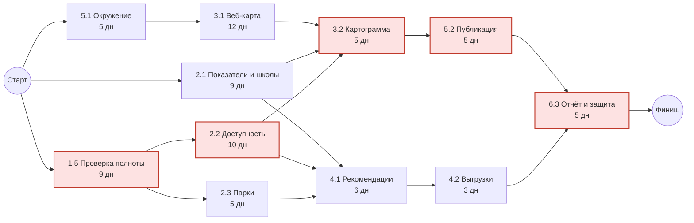
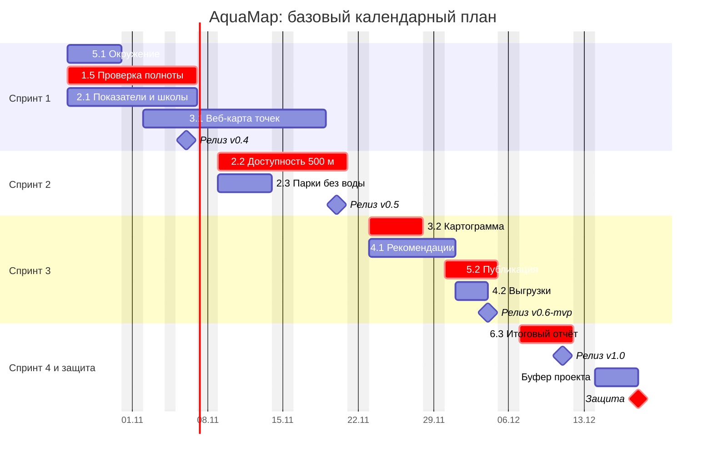

# Лабораторная работа №3
## Планирование: оценка, календарный план, ресурсы и бюджет

Вход: бэклог с эпиками и историями, WBS со словарём, DoR/DoD, заключение об осуществимости и устав версии 1.1 из ЛР 2.
Выход: оценки работ, сетевой график и критический путь, календарный план с буфером, план ресурсов, релизный план со спринтами, бюджет с расчётом окупаемости, план коммуникаций, спланированный Sprint 1 и релиз `v0.3-plan`.

---

## 1. О чём эта работа

После ЛР 2 команда знает, что делать: есть бэклог, WBS и понятно, каких данных хватает. Но заказчик и спонсор задают другие вопросы: когда будет готово, сколько это стоит и успеем ли мы вообще. В этой работе вы на них ответите.

Вы оцените работы двумя способами: истории — в относительных единицах (story points), пакеты WBS — в часах с учётом неопределённости. Затем свяжете работы зависимостями, найдёте критический путь и построите календарный план. Проверите, хватает ли людей, и выровняете загрузку. Разложите работу на спринты и настроите Roadmap в GitHub. Посчитаете бюджет и прикинете, окупится ли продукт для заказчика.

Итог работы называется **базовым планом (baseline)**. Это согласованная версия сроков, стоимости и содержания, с которой дальше сравнивается факт. В ЛР 5 вы будете измерять отклонения именно от неё, поэтому план должен быть честным, а не красивым.

**К концу работы вы сможете:**
- оценивать истории методом Planning Poker и пакеты работ методом трёх точек (PERT);
- строить сетевой график, находить критический путь и резервы времени;
- строить календарный план с вехами и буфером в виде диаграммы Ганта;
- считать ёмкость команды и выравнивать загрузку;
- составлять релизный план и цели спринтов;
- считать бюджет проекта с резервами, стоимость владения и простую окупаемость;
- составлять план коммуникаций;
- настраивать в GitHub Projects спринты, оценки, Roadmap и автоматизации.

---

## 2. Краткая справка

### Оценка

| Термин | Что это простыми словами |
|---|---|
| **Оценка трудоёмкости** | Сколько работы нужно, чтобы получить результат. Измеряется в часах (человеко-часах) или в относительных единицах. Не путайте с длительностью: работа на 10 часов может занять 2 недели, если исполнитель занят ею час в день. |
| **Story points (SP)** | Относительная мера размера истории: насколько она больше или меньше эталонной. Учитывает объём, сложность и неопределённость. Часы из SP напрямую не пересчитываются. |
| **Шкала Фибоначчи** | Набор значений для SP: 1, 2, 3, 5, 8, 13, 21. Чем больше история, тем грубее оценка, поэтому промежуточных значений нет. История больше 13 — кандидат на разделение. |
| **Эталонная история** | История, которую команда договорилась считать за известное число SP. С ней сравниваются все остальные. |
| **Planning Poker** | Способ оценки в команде: каждый одновременно показывает свою оценку, а при расхождении крайние объясняют свои доводы, и все голосуют снова. Одновременность защищает от «эффекта якоря», когда все подстраиваются под первого. |
| **Трёхточечная оценка (PERT)** | Для каждой работы называют три оценки: оптимистичную (O), наиболее вероятную (M) и пессимистичную (P). Ожидаемое значение \(E = (O + 4M + P) / 6\), стандартное отклонение \(\sigma = (P - O) / 6\). |
| **Спайк с ограничением по времени (timebox)** | Исследовательскую задачу не оценивают, а ограничивают: «не больше 6 часов». По истечении времени команда решает, что делать дальше. |

### Сроки

| Термин | Что это простыми словами |
|---|---|
| **Длительность** | Сколько рабочих дней занимает работа в календаре. Зависит от трудоёмкости и того, сколько часов в день исполнитель может ей уделить. |
| **Зависимость** | Работа B не может начаться, пока не закончена работа A («окончание — начало»). Бывают внутренние (между работами команды) и внешние (от заказчика, источника данных, другой команды). |
| **Сетевой график** | Схема работ и зависимостей между ними. По нему считают сроки. |
| **Критический путь (CPM)** | Самая длинная цепочка зависимых работ от начала до конца проекта. Её длина и есть срок проекта. Задержка любой работы на критическом пути сдвигает весь проект. |
| **Ранние и поздние сроки** | ES/EF: самое раннее начало и окончание работы. LS/LF: самое позднее начало и окончание, при которых проект не сдвигается. |
| **Резерв времени (slack, float)** | Насколько можно задержать работу без сдвига проекта: \(LS - ES\). У работ на критическом пути резерв равен нулю. |
| **Веха (milestone)** | Событие без длительности: «релиз MVP», «защита». |
| **Буфер проекта** | Запас времени в конце плана, который защищает срок от неточности оценок. Его не раздают по задачам, а расходуют только при необходимости. |
| **Диаграмма Ганта** | Календарный план в виде полос на шкале времени. В курсе строится в Mermaid прямо в Markdown. |
| **Базовый план (baseline)** | Утверждённая версия плана. Дальнейшие изменения идут через запрос на изменение (ЛР 5), а базовый план остаётся точкой сравнения. |

### Ресурсы, спринты и бюджет

| Термин | Что это простыми словами |
|---|---|
| **Ёмкость (capacity)** | Сколько часов команда реально может дать в спринт: время участников минус встречи, отсутствия и праздники. |
| **Скорость (velocity)** | Сколько SP команда закрывает за спринт. До первых спринтов это только гипотеза, после двух-трёх спринтов — измеренный факт. |
| **Выравнивание ресурсов** | Перестановка работ или исполнителей, чтобы никто не был перегружен. Сначала используются резервы времени некритических работ, только потом сдвигаются сроки. |
| **Релизный план** | Какие истории в каком спринте и в каком релизе будут готовы. |
| **Цель спринта (Sprint Goal)** | Одна фраза о том, какую ценность даст спринт. По ней на обзоре решают, удался ли спринт, даже если какая-то мелкая задача не успела. |
| **Roadmap** | Обзорный план на шкале времени: эпики, спринты, вехи. Показывает заказчику картину без деталей. |
| **Бюджет по статьям (bottom-up)** | Бюджет, собранный снизу вверх из оценок работ и прочих расходов. Точнее оценки «по порядку величины» из устава. |
| **Резерв на риски (contingency reserve)** | Деньги и часы на известные риски из реестра. Входит в базовый бюджет. |
| **Управленческий резерв (management reserve)** | Запас на непредвиденное. В базовый бюджет не входит, расходуется только с разрешения спонсора. |
| **TCO** | Полная стоимость владения: разработка плюс поддержка и эксплуатация за несколько лет. |
| **ROI, NPV, срок окупаемости** | ROI — отношение чистой выгоды к затратам. NPV — сумма будущих выгод минус затраты с учётом того, что деньги в будущем стоят меньше (дисконтирование). Срок окупаемости — через сколько лет выгоды покроют затраты. |

---

## 3. Учебный пример: AquaMap Ekaterinburg (продолжение)

В ЛР 2 команда AquaMap утвердила MVP, шесть эпиков и WBS и выяснила, что данных «достаточно с оговорками». На обзоре заказчик попросил добавить анализ школ, а по рискам появились задачи на проверку полноты данных и уточнение жилой застройки.

Исходные условия для планирования:
- **Команда:** Иван П., Анна С., Олег К., у каждого 6 часов в неделю на проект.
- **Семестр:** работы идут с 7 сентября 2026 года. На ЛР 1–3 ушло 7 недель. С 26 октября по 11 декабря осталось 7 рабочих недель на разработку, защита проекта — 18 декабря. 4 ноября — праздник, нерабочий день.
- **Устав:** бюджет по порядку величины 252 000 руб. и резерв 15% (37 800 руб.). Ставка условная, 1 000 руб. в час. Подход гибридный: вехи и бюджет планируются заранее, продукт делается двухнедельными спринтами.
- **Ритуалы:** у каждого около часа в неделю уходит на встречи и отчёты. На работу над продуктом остаётся 5 часов в неделю на человека.

Все цифры в примере взаимосвязаны: оценки из шага 2 попадают в сетевой график шага 3, тот — в календарь и спринты, а часы — в бюджет. Повторите эту цепочку на своём проекте.

---

## 4. Роли в этой работе

Менеджером проекта снова становится новый участник: тот, кто ещё не был им в ЛР 1 и ЛР 2. В группе из двух человек роль возвращается к участнику из ЛР 1.

| Роль | Чем занимается в ЛР 3 |
|---|---|
| Менеджер проекта (новый) | Сетевой график, критический путь, календарный план, ресурсы, план коммуникаций, контрольная точка |
| Владелец продукта | Проводит Planning Poker, отвечает за релизный план, цели спринтов и порядок бэклога |
| Финансовый аналитик | Бюджет, резервы, стоимость владения и окупаемость |
| Технический лидер | Оценки технических работ и работ с данными, зависимости, настройка GitHub Projects и автоматизаций |

В группе из 2–3 человек роли совмещаются. Удобно так: менеджер + финансовый аналитик, владелец продукта + технический лидер. В примере AquaMap менеджер в ЛР 3 — Олег, владелец продукта — Анна, бюджетом и настройкой GitHub занимается Иван.

Правила прежние: нет задачи — нет работы, всё в `main` через Pull Request с ревью, использование ИИ записывается в `docs/ai-usage.md`.

---

## 5. Пошаговое задание

### Шаг 0. Подготовка репозитория и передача дел (20 минут)

**Обновите репозиторий** из шаблона так же, как в ЛР 2:

```bash
git fetch template
git switch -c chore/lab3-files
git checkout template/main -- docs/estimation.md docs/schedule.md docs/budget.md \
  docs/communication-plan.md docs/tasks/lab-3-assignment.md \
  notebooks/04_plan_calculator.ipynb .github/workflows .github/scripts
git commit -m "chore: add lab 3 files from template"
git push -u origin chore/lab3-files
```

Если удалённый репозиторий `template` ещё не добавлен, сначала выполните `git remote add template https://github.com/aydarabdullin/pm-lab-template.git`. Затем создайте Pull Request и влейте его.

**Подготовьте трекер.** Запустите **Actions → Bootstrap: метки, этап и стартовые задачи → Run workflow** с номером **3**. Появятся этап «ЛР3: Планирование» и стартовые задачи. Укажите в этапе дату сдачи и назначьте исполнителей.

**Передайте дела.** Прежний менеджер рассказывает новому, что открыто на доске и какие замечания заказчик оставил на обзоре ЛР 2. Обновите таблицу ролей в README.

---

## Часть А. Оценка

### Шаг 1. Оцените истории: Planning Poker (40 минут)

#### Что сделать

1. **Подготовьте список.** Возьмите истории MVP и истории, которые появились после обзора ЛР 2. Проверьте каждую по DoR: без критериев приёмки историю не оценивают, сначала её дорабатывают.
2. **Выберите эталон.** Найдите историю среднего размера, понятную всем, и договоритесь, что она стоит 3 SP.
3. **Проведите Planning Poker.** Для каждой истории:
   - владелец продукта зачитывает историю и критерии приёмки, команда задаёт вопросы;
   - каждый выбирает карту (1, 2, 3, 5, 8, 13, 21 или «?») и все показывают одновременно;
   - если оценки совпали или соседние, берите большую или договоритесь;
   - если разошлись сильно, участники с крайними оценками объясняют свои доводы, и все голосуют повторно. Обычно хватает двух раундов.
4. **Разделите крупные истории.** История на 13 SP и больше обычно не помещается в спринт. Разделите её на 2–3 истории, каждая из которых сама по себе даёт результат.
5. **Ограничьте спайки по времени.** Исследовательские задачи, например проверку полноты данных, не оценивайте в SP. Задайте им лимит времени в часах.
6. **Запишите оценки** в поле `Estimate` на доске и в `docs/estimation.md`. Для спорных оценок кратко запишите, о чём спорили и что решили. Это пригодится, если оценка не подтвердится.

Карты для покера не нужны: подойдут пальцы, бумажки или любой бесплатный сервис для Planning Poker. Главное условие — показывать оценки одновременно.

#### Как это сделала команда AquaMap

**Эталон.** Команда выбрала US-4 «Список парков без питьевой воды с площадью». Она понятна всем: в ЛР 2 почти такой же расчёт уже был сделан в ноутбуке 03. Ей дали 3 SP.

**Самый интересный раунд — US-2** «Картограмма доли домов без воды в пешей доступности».

| Раунд | Анна | Олег | Иван | Что обсуждали |
|---|---|---|---|---|
| 1 | 5 | 13 | 8 | Олег считал расстояния по пешеходной сети, Анна — по прямой, как в ЛР 2 |
| 2 | 8 | 8 | 8 | Анна напомнила требование к данным: в MVP расстояние по прямой, сеть — история на следующую версию. Олег снизил оценку, но обратил внимание на проверку расчёта вторым участником |

Здесь видно, зачем нужна одновременность: если бы первой высказалась Анна, остальные, скорее всего, согласились бы с 5. Тогда разница в понимании задачи всплыла бы только в середине спринта.

**Итог оценки.**

| ID | История | Эпик | MoSCoW | SP |
|---|---|---|---|---|
| US-2 | Картограмма доли домов без воды в пешей доступности | E2 | Must | 8 |
| US-3 | Все точки питьевой воды на карте | E3 | Must | 5 |
| US-4 | Список парков без питьевой воды (эталон) | E4 | Must | 3 |
| US-5 | Карта по ссылке без установки программ | E5 | Should | 3 |
| US-6 | Школы без питьевой воды в 300 м (добавлена на обзоре ЛР 2) | E2 | Should | 5 |
| US-7 | Уточнение жилой застройки (по риску R5) | E1 | Should | 3 |
| US-1 | Обновление данных по инструкции | E1 | Should | — (вне MVP, не оценивали) |
| #41 | Спайк: выборочная проверка полноты по снимкам | E1 | — | лимит 6 ч |

Итого MVP: 27 SP.

**Результат шага:** оценки в поле `Estimate`, таблица и записи о спорных оценках в `docs/estimation.md`.

---

### Шаг 2. Оцените пакеты работ тремя точками (40–50 минут)

#### Зачем две оценки

Story points удобны для спринтов: команда сравнивает истории между собой и быстро планирует. Но сроки и бюджет нужно считать в часах и днях, и не только для историй: в WBS есть работы, которые пользователь не видит (окружение, отчёт, защита). Поэтому для базового плана оцениваются **пакеты работ WBS в часах**, а SP используются для планирования спринтов.

Одной цифры в часах мало: она прячет неопределённость. Работа «8 часов» может занять и 6, и 20, если сервер с данными будет недоступен. Трёхточечная оценка делает эту неопределённость видимой.

#### Что сделать

1. Возьмите из словаря WBS пакеты работ, которые ещё **не выполнены**. Работы ЛР 1–2 уже сделаны, их не оценивают.
2. Для каждого пакета назовите три оценки в часах:
   - **O, оптимистичная:** всё идёт гладко, данные на месте, ничего не ломается;
   - **M, наиболее вероятная:** как обычно бывает;
   - **P, пессимистичная:** проблемы, которые реально случаются (не катастрофа). Для работ с данными сюда входят перегрузка сервера, неожиданные пропуски и повторная загрузка.
3. Посчитайте \(E = (O + 4M + P) / 6\) и \(\sigma = (P - O) / 6\) для каждого пакета.
4. Сложите E по всем пакетам: это ожидаемая трудоёмкость. Неопределённость всего проекта: \(\sigma_{проекта} = \sqrt{\sum \sigma_i^2}\). Складываются квадраты, а не сами σ, потому что ошибки разных работ частично гасят друг друга.
5. Оцените работу с уровнем уверенности 85%: \(E + 1{,}04 \cdot \sigma_{проекта}\). Эта цифра понадобится для резерва.
6. Отдельно оцените **управленческую работу**: встречи, отчёты, обзоры. Её удобно считать не тремя точками, а как постоянную долю времени, например час в неделю на человека.
7. Запишите расчёт в `docs/estimation.md`. Для самопроверки воспользуйтесь ноутбуком `notebooks/04_plan_calculator.ipynb` (приложение А).

**Почему не сумма M.** Пессимистичная оценка обычно дальше от вероятной, чем оптимистичная: сделать работу вдвое быстрее почти невозможно, а вдвое медленнее — легко. Поэтому E почти всегда больше M. Если планировать по M, план систематически оказывается оптимистичным.

#### Как это сделала команда AquaMap

| Код | Пакет работ | O | M | P | E | σ |
|---|---|---|---|---|---|---|
| 1.5 | Проверка полноты и уточнение застройки | 4 | 8 | 16 | 8,7 | 2,0 |
| 2.1 | Показатели по районам и школы | 5 | 8 | 14 | 8,5 | 1,5 |
| 2.2 | Доступность 500 м | 6 | 9 | 18 | 10,0 | 2,0 |
| 2.3 | Парки без воды | 3 | 5 | 9 | 5,3 | 1,0 |
| 3.1 | Веб-карта: слой точек | 6 | 10 | 20 | 11,0 | 2,3 |
| 3.2 | Картограмма районов | 4 | 6 | 12 | 6,7 | 1,3 |
| 4.1 | Рекомендации по размещению | 6 | 8 | 14 | 8,7 | 1,3 |
| 4.2 | Выгрузки для департамента | 2 | 3 | 6 | 3,3 | 0,7 |
| 5.1 | Окружение и автопроверки | 4 | 6 | 12 | 6,7 | 1,3 |
| 5.2 | Публикация на GitHub Pages | 3 | 5 | 12 | 5,8 | 1,5 |
| 6.3 | Итоговый отчёт и защита | 8 | 12 | 20 | 12,7 | 2,0 |
| | **Итого** | | **80** | | **87,3** | **5,4** |

Как читать результат:
- Сумма вероятных оценок 80 часов, а ожидаемая трудоёмкость 87,3 часа. Разница в 7 часов — та самая систематическая оптимистичность, о которой шла речь выше.
- \(\sigma_{проекта} = \sqrt{28{,}7} \approx 5{,}4\) ч. С уверенностью 85% работа займёт не больше \(87{,}3 + 1{,}04 \cdot 5{,}4 \approx 93\) часов.
- Самые неопределённые пакеты — веб-карта (3.1) и доступность (2.2): у них самый большой разброс. Олег отметил это для ЛР 4: эти работы стоит начинать с прототипа.
- Управленческая работа: 3 человека × 1 ч × 7 недель = 21 час.

**Результат шага:** трёхточечные оценки, ожидаемая трудоёмкость и уровень 85% в `docs/estimation.md`.

---

## Часть Б. Сроки и ресурсы

### Шаг 3. Постройте сетевой график и найдите критический путь (50–60 минут)

#### Что сделать

1. **Определите длительности.** Переведите часы в рабочие дни с учётом того, сколько исполнитель может уделять работе. При 5 часах в неделю это около часа в день, но работы перемежаются, поэтому округляйте с запасом и не делите механически.
2. **Определите зависимости.** Для каждого пакета спросите: что должно быть готово до его начала? Отдельно отметьте внешние зависимости: доступ к источнику данных, ответ заказчика, обзор. Работы с данными обычно стоят в начале цепочек, потому что от них зависит аналитика, а от аналитики — интерфейс и отчёты.
3. **Нарисуйте сетевой график** в `docs/schedule.md` (Mermaid `flowchart LR`).
4. **Посчитайте сроки:**
   - **прямой проход:** ES работы = максимум EF её предшественников, EF = ES + длительность;
   - **обратный проход:** LF работы = минимум LS её последователей (для последней работы LF = срок проекта), LS = LF − длительность;
   - **резерв** = LS − ES.
5. **Выделите критический путь:** работы с нулевым резервом. Проверьте, что срок проекта укладывается в доступное время. Если нет, есть три пути: сократить содержание (обсудить с владельцем продукта), выполнить работы параллельно, перераспределить людей. Решение запишите.

Отсчёт ведите в рабочих днях от начала периода: день 0 — первый рабочий день. Сверить ручной расчёт можно в ноутбуке 04.

#### Как это сделала команда AquaMap

**Зависимости.** Олег прошёл по WBS и задал по каждому пакету вопрос «что нужно до начала».
- Доступность 500 м (2.2) и парки (2.3) зависят от проверки полноты (1.5): считать доступность по неполным данным нет смысла.
- Показатели по районам (2.1) не зависят от проверки: районы и население уже готовы, а слой школ загружается внутри самой работы.
- Веб-карта (3.1) зависит от окружения (5.1).
- Картограмма (3.2) требует трёх работ: веб-карты, показателей и доступности.
- Рекомендации (4.1) строятся на показателях, доступности и парках.
- Публикация (5.2) — после картограммы, выгрузки (4.2) — после рекомендаций, итоговый отчёт (6.3) — после публикации и выгрузок.



**Расчёт (в рабочих днях от 26 октября).**

| Работа | Длит. | ES | EF | LS | LF | Резерв |
|---|---|---|---|---|---|---|
| 5.1 Окружение и автопроверки | 5 | 0 | 5 | 2 | 7 | 2 |
| 1.5 Проверка полноты | 9 | 0 | 9 | 0 | 9 | **0** |
| 2.1 Показатели и школы | 9 | 0 | 9 | 10 | 19 | 10 |
| 3.1 Веб-карта | 12 | 5 | 17 | 7 | 19 | 2 |
| 2.2 Доступность 500 м | 10 | 9 | 19 | 9 | 19 | **0** |
| 2.3 Парки без воды | 5 | 9 | 14 | 15 | 20 | 6 |
| 3.2 Картограмма | 5 | 19 | 24 | 19 | 24 | **0** |
| 4.1 Рекомендации | 6 | 19 | 25 | 20 | 26 | 1 |
| 5.2 Публикация | 5 | 24 | 29 | 24 | 29 | **0** |
| 4.2 Выгрузки | 3 | 25 | 28 | 26 | 29 | 1 |
| 6.3 Отчёт и защита | 5 | 29 | 34 | 29 | 34 | **0** |

Как считалась одна строка. Картограмма (3.2) ждёт веб-карту (EF = 17), показатели (EF = 9) и доступность (EF = 19). Значит, она начинается не раньше дня 19 и заканчивается в день 24. На обратном проходе её единственный последователь — публикация с LS = 24, поэтому LF картограммы 24, а резерв равен нулю.

**Критический путь:** проверка полноты → доступность → картограмма → публикация → отчёт. Длина 34 рабочих дня, то есть с 26 октября по 11 декабря с учётом праздника 4 ноября.

**Выводы команды.**
- Критический путь начинается с работы по данным. Если проверка полноты затянется, сдвинется всё. Олег поставил её первой задачей Sprint 1 и взял на себя, не назначая себе на это время других работ.
- У показателей по районам большой резерв (10 дней). Их можно начать позже, если понадобятся люди на критические работы.
- Рекомендации и выгрузки идут почти по критическому пути (резерв 1 день). Их нужно контролировать так же внимательно.

**Результат шага:** сетевой график и таблица расчёта в `docs/schedule.md`, критический путь выделен.

---

### Шаг 4. Постройте календарный план с вехами и буфером (30–40 минут)

#### Что сделать

1. Переведите расчёт в календарные даты: исключите выходные и праздники.
2. Постройте **диаграмму Ганта** в `docs/schedule.md` (Mermaid `gantt`). Используйте зависимости `after`, выделите критические работы меткой `crit`.
3. Добавьте **вехи**: релизы в конце спринтов, обзоры с заказчиком, защиту.
4. Добавьте **буфер проекта** в конце, перед финальной вехой. Ориентир: не меньше разницы между оценкой с уверенностью 85% и ожидаемой (шаг 2), пересчитанной в дни. Буфер не раздаётся по задачам.
5. Проверьте план глазами заказчика: видно ли, когда он получит первый результат и когда финальный?

**Подсказка по Mermaid.** Строка `excludes weekends, 2026-11-04` убирает выходные и праздник, и длительности `5d` считаются в рабочих днях. GitHub отображает такие диаграммы прямо в Markdown.

#### Как это сделала команда AquaMap



**Буфер.** Разница между уровнем 85% и ожидаемой оценкой около 6 часов на команду. При трёх участниках это 2–3 рабочих дня. Олег заложил 4 дня (14–17 декабря) с запасом на праздничный декабрь и болезни. Защита 18 декабря — жёсткая веха, её сдвигать нельзя.

**Вехи для заказчика:** промежуточные релизы в конце каждого спринта, MVP — 4 декабря, финальная версия — 11 декабря. Первый результат, который можно показать (черновик карты точек), появится в конце Sprint 1.

**Результат шага:** диаграмма Ганта с вехами и буфером в `docs/schedule.md`.

---

### Шаг 5. Проверьте ресурсы и выровняйте загрузку (30–40 минут)

#### Что сделать

1. **Посчитайте ёмкость** каждого участника на каждый спринт: часы в неделю × недели − встречи − известные отсутствия. Спросите каждого о планах: сессия, работа, поездки.
2. **Составьте матрицу загрузки:** строки — участники, столбцы — спринты, в ячейках — часы по назначенным пакетам (по графику из шага 4). Пакет, который идёт через два спринта, разделите по дням.
3. **Найдите перегрузки:** загрузка выше 100% ёмкости. Небольшой перебор до 5–10% допустим, больший — нет.
4. **Выровняйте загрузку** в таком порядке:
   - передать работу другому участнику, у которого есть время;
   - сдвинуть некритическую работу в пределах её резерва;
   - только если не помогло, сдвинуть сроки или сократить содержание.
5. Запишите матрицу до и после выравнивания в `docs/schedule.md` и назначьте исполнителей в задачах.

#### Как это сделала команда AquaMap

**Ёмкость.** 5 часов работы над продуктом в неделю на человека: 10 часов в двухнедельный спринт, 5 часов в недельный Sprint 4. Известных отсутствий нет.

**Первоначальное распределение «по ролям».** Олегу как геоаналитику достались все пространственные расчёты, Анне — показатели и отчёты, Ивану — интерфейс и публикация. Матрица показала две проблемы:

| Участник | Sprint 1 | Sprint 2 | Sprint 3 | Sprint 4 |
|---|---|---|---|---|
| Анна | 8,5 (85%) | **0 (0%)** | **12,0 (120%)** | 4,2 (84%) |
| Олег | 8,7 (87%) | **15,3 (153%)** | 6,7 (67%) | 4,2 (84%) |
| Иван | 10,3 (103%) | 7,3 (73%) | 5,8 (58%) | 4,2 (84%) |

**Решения.**
1. «Парки без воды» (2.3) переданы от Олега Анне. Это не критическая работа, а расчёт почти повторяет ноутбук из ЛР 2. Олег в Sprint 2 занимается только доступностью — работой на критическом пути.
2. «Выгрузки» (4.2) переданы от Анны Ивану: в Sprint 3 у него есть время, а выгрузка — техническая задача.

**После выравнивания.**

| Участник | Sprint 1 | Sprint 2 | Sprint 3 | Sprint 4 | Всего |
|---|---|---|---|---|---|
| Анна | 8,5 (85%) | 5,3 (53%) | 8,7 (87%) | 4,2 (84%) | 26,7 |
| Олег | 8,7 (87%) | 10,0 (100%) | 6,7 (67%) | 4,2 (84%) | 29,6 |
| Иван | 10,3 (103%) | 7,3 (73%) | 9,2 (92%) | 4,2 (84%) | 31,1 |
| **Команда** | 27,5 из 30 | 22,6 из 30 | 24,6 из 30 | 12,7 из 15 | **87,3 из 105** |

Обе передачи сделаны в пределах резерва работ, поэтому календарный план не изменился. Свободное время в Sprint 2 у Анны пойдёт на подготовку статус-отчёта и работы ЛР 4 по рискам. Свободные 18 часов команды — это запас на неточность оценок, его не нужно заполнять новыми задачами.

**Результат шага:** ёмкость, матрица загрузки до и после выравнивания, исполнители назначены в задачах.

---

### Шаг 6. Составьте релизный план и настройте Roadmap в GitHub (40–50 минут)

#### Что сделать

1. **Нарежьте работу на спринты** по календарному плану: в какой спринт попадает каждая история и задача.
2. **Сформулируйте цель каждого спринта** одной фразой о ценности: не «сделать задачи 21–25», а «департамент видит черновик карты точек».
3. **Проверьте план по скорости.** Посчитайте SP историй в каждом спринте. Скорость пока гипотеза: возьмите сумму SP MVP и поделите на число спринтов. Спринт, который заметно больше гипотезы, — риск: заранее решите, какая история переедет, если скорость не подтвердится.
4. **Назначьте релизы** на конец спринтов: что заказчик получит в каждом.
5. **Настройте GitHub Projects** (подробно в приложении Б):
   - поле `Sprint` типа **Iteration**, длительность 2 недели, начало — первый день Sprint 1;
   - поле `Estimate` типа **Number** (если не создано в ЛР 2);
   - представление **«Roadmap»** с макетом Roadmap: эпики на шкале времени по `Start date` и `Target date`, маркеры спринтов;
   - представление **«Спринт»**: доска с фильтром по текущему спринту;
   - встроенные автоматизации (**Workflows**): закрытая задача и влитый PR переводятся в `Done`, новые задачи репозитория автоматически добавляются на доску.
6. **Уточните даты эпиков** (`Start date`, `Target date`) по календарному плану.

**Этапы и спринты — разные вещи.** В курсе этап (Milestone) — это лабораторная работа: «ЛР3: Планирование», «ЛР4: …». Спринт ведётся полем Iteration на доске. Так у задачи может быть и этап, и спринт, и их можно смотреть по отдельности.

#### Как это сделала команда AquaMap

| Спринт | Даты | Цель спринта | Истории (SP) | Пакеты WBS | Релиз |
|---|---|---|---|---|---|
| Sprint 1 | 26.10–06.11 | Данные проверены, окружение готово, есть показатели по районам и школам | US-6 (5), US-7 (3), спайк #41 | 1.5, 2.1, 5.1, начало 3.1 | v0.4 |
| Sprint 2 | 09.11–20.11 | Департамент видит все точки на карте и список парков без воды | US-3 (5), US-4 (3) | 2.2, 2.3, окончание 3.1 | v0.5 |
| Sprint 3 | 23.11–04.12 | Департамент открывает по ссылке картограмму доступности и рекомендации | US-2 (8), US-5 (3) | 3.2, 4.1, 4.2, 5.2 | v0.6-mvp |
| Sprint 4 | 07.12–11.12 | Продукт принят, итоговый отчёт готов | приёмка, исправления | 6.3 | v1.0 |

**Проверка по скорости.** В MVP 27 SP на три полноценных спринта, гипотеза скорости — 8–9 SP за спринт. Sprint 3 с 11 SP тяжелее остальных. Решение Анны: если в Sprint 1 и 2 команда закроет меньше 8 SP, US-5 «Карта по ссылке» переносится в Sprint 4. Публикация на GitHub Pages проще остальных работ и не блокирует картограмму.

**Roadmap.** Иван создал представление «Roadmap»: шесть эпиков на шкале времени, вертикальные маркеры спринтов, масштаб **Month**. Эпик E6 «Управление проектом» тянется через весь семестр, E3 «Пользовательский интерфейс» — со 2 по 27 ноября.

**Результат шага:** релизный план с целями спринтов в `docs/schedule.md`, поле `Sprint` на доске, представления «Roadmap» и «Спринт», включённые автоматизации, уточнённые даты эпиков.

---

## Часть В. Бюджет и коммуникации

### Шаг 7. Составьте бюджет проекта (40 минут)

#### Что сделать

1. **Соберите бюджет снизу вверх** в `docs/budget.md`:
   - **факт:** часы, уже потраченные на ЛР 1–3 (по записям в задачах или по договорённости с преподавателем);
   - **работы по продукту:** ожидаемая трудоёмкость E из шага 2;
   - **управление:** встречи и отчёты из шага 2;
   - **прочие расходы:** сервисы, API, хостинг, лицензии на данные, печать, поездки. Если сервис бесплатный, всё равно укажите его с нулём и ограничениями бесплатного тарифа: это может стать риском.
2. **Добавьте резерв на риски.** Для 2–3 главных рисков из реестра оцените, во что обойдётся реакция. Можно ориентироваться и на разницу между уровнем 85% и E из шага 2.
3. **Получите базовый бюджет:** работы + прочие расходы + резерв на риски.
4. **Добавьте управленческий резерв** (5–10%): это бюджет проекта, который утверждает спонсор.
5. **Сравните с уставом.** Укладываетесь ли вы в бюджет по порядку величины? Если нет, объясните разницу и предложите варианты.
6. **Распределите бюджет по спринтам.** Этот план накопленных затрат понадобится в ЛР 5 для сравнения с фактом.

Ставка часа условная, та же, что в ЛР 1. Для учебного проекта важна не точность рублей, а логика: из чего складывается бюджет, где резервы и кто ими распоряжается.

#### Как это сделала команда AquaMap

| Статья | Часы | Сумма, руб. | Откуда цифра |
|---|---|---|---|
| Факт ЛР 1–3 (недели 1–7) | 126 | 126 000 | 3 человека × 6 ч × 7 недель |
| Работы по продукту | 87 | 87 000 | Ожидаемая трудоёмкость E (шаг 2) |
| Управление и ритуалы | 21 | 21 000 | 3 × 1 ч × 7 недель |
| **Трудозатраты** | **234** | **234 000** | |
| GitHub, Google Colab, Google Диск | — | 0 | Бесплатные тарифы. Ограничение: сессия Colab до 12 часов, Диск 15 ГБ |
| OpenStreetMap, Overpass API | — | 0 | ODbL, без оплаты. Ограничение: Overpass может быть перегружен |
| Печать материалов для заказчика | — | 1 000 | Раздаточные материалы на защиту |
| **Прочие расходы** | | **1 000** | |
| Резерв на риски | 15 | 15 000 | R1 (полнота данных): повторная проверка, 6 ч; R3 (изменение требований): 6 ч; неточность оценок: 3 ч |
| **Базовый бюджет** | **249** | **250 000** | |
| Управленческий резерв, 5% | | 12 500 | Только с разрешения спонсора |
| **Бюджет проекта** | | **262 500** | |

**Сравнение с уставом.** В уставе было 252 000 руб. плюс резерв 37 800 руб., всего 289 800 руб. Бюджет проекта по плану — 262 500 руб., на 27 300 руб. меньше. Иван объяснил разницу: в уставе резерв был 15% «на всякий случай», а теперь резервы посчитаны по конкретным рискам и неопределённости оценок.

**Проверка по ёмкости.** На 7 недель разработки у команды 126 часов. План: 87 + 21 = 108 часов, с резервом на риски 123 часа. Резерв почти исчерпывает остаток времени. Это значит, что любые новые запросы заказчика пойдут только через запрос на изменение с пересмотром содержания.

**Распределение по спринтам (план накопленных затрат).**

| На конец | Работы, ч | Управление, ч | Накоплено, руб. |
|---|---|---|---|
| ЛР 3 (факт) | — | — | 126 000 |
| Sprint 1 | 27,5 | 6 | 159 500 |
| Sprint 2 | 22,6 | 6 | 188 100 |
| Sprint 3 | 24,6 | 6 | 218 700 |
| Sprint 4 | 12,7 | 3 | 234 400 |

Небольшая разница с итогом 234 000 руб. — следствие округления. Резерв на риски в этот план не включается: его расходуют только при наступлении риска.

**Результат шага:** `docs/budget.md` с бюджетом по статьям, резервами, сравнением с уставом и планом по спринтам.

---

### Шаг 8. Оцените стоимость владения и окупаемость (30 минут)

#### Что сделать

1. **Посчитайте стоимость владения (TCO)** на 3 года: базовый бюджет плюс ежегодная поддержка (обновление данных, исправления, хостинг).
2. **Оцените выгоду заказчика в рублях в год.** Это самая спорная часть, поэтому опирайтесь на бизнес-обоснование из ЛР 1 и записывайте допущения. Типичные источники выгоды: сэкономленное время сотрудников, отказ от услуг подрядчика, предотвращённые потери.
3. **Посчитайте:**
   - чистый денежный поток в год = выгода − поддержка;
   - NPV = \(-I + \sum_{t=1}^{3} CF_t / (1 + r)^t\), где I — затраты на разработку, \(CF_t\) — поток года t, r — ставка дисконтирования (условно 20%, согласуйте с преподавателем);
   - ROI = (выгода за 3 года − TCO) / TCO;
   - срок окупаемости = I / годовой поток.
4. **Проверьте чувствительность:** при какой выгоде NPV становится отрицательным? Если запас небольшой, это аргумент для разговора с заказчиком о том, насколько надёжна оценка выгоды.
5. Запишите расчёт и допущения в `docs/budget.md`.

#### Как это сделала команда AquaMap

**Допущения.** Без продукта департамент каждый год заказывает у подрядчика аналитическую справку о размещении питьевых точек. По данным из бизнес-обоснования ЛР 1 (условно), это 150 000 руб. в год. Продукт заменяет справку. Поддержка: квартальное обновление данных по инструкции (US-1) и мелкие исправления — 18 часов, то есть 18 000 руб. в год. Хостинг на GitHub Pages бесплатный.

| Показатель | Расчёт | Значение |
|---|---|---|
| Затраты на разработку I | Базовый бюджет | 250 000 руб. |
| TCO за 3 года | 250 000 + 3 × 18 000 | 304 000 руб. |
| Годовой чистый поток | 150 000 − 18 000 | 132 000 руб. |
| Дисконтированный поток за 3 года | 132 000 × (1/1,2 + 1/1,2² + 1/1,2³) = 132 000 × 2,1065 | 278 056 руб. |
| NPV при ставке 20% | 278 056 − 250 000 | **+28 056 руб.** |
| ROI за 3 года | (450 000 − 304 000) / 304 000 | 48% |
| Срок окупаемости | 250 000 / 132 000 | около 1,9 года |

**Чувствительность.** Если выгода окажется не 150 000, а 120 000 руб. в год, годовой поток будет 102 000 руб., а NPV станет отрицательным: около −35 000 руб. Запас прочности небольшой. Вывод Ивана для заказчика: «Проект окупается за два года, если продукт действительно заменит справку подрядчика. Это стоит подтвердить у заказчика до защиты». Вопрос добавлен в повестку обзора.

Есть и выгоды, которые сложно выразить в рублях: открытая карта для жителей, прозрачность решений департамента. Их стоит назвать, но не включать в NPV.

**Результат шага:** TCO, NPV, ROI, срок окупаемости и проверка чувствительности в `docs/budget.md`.

---

### Шаг 9. Составьте план коммуникаций (25–30 минут)

#### Что сделать

1. Возьмите реестр стейкхолдеров из ЛР 1. Для ключевых стейкхолдеров решите, что, как часто и через какой канал они получают.
2. Заполните `docs/communication-plan.md`: встреча или документ, цель, участники, частота, длительность, канал, ответственный, результат (где остаётся след).
3. Опишите ритуалы команды: планирование спринта, короткие синхронизации, обзор, ретроспектива. Учитывайте реальность: у студентов нет ежедневных восьми часов, поэтому ежедневная встреча может быть письменной.
4. Договоритесь о правилах эскалации: когда и как менеджер сообщает спонсору о проблеме.
5. Подготовьте шаблон статус-отчёта. Первый настоящий отчёт будет в конце Sprint 1.

#### Как это сделала команда AquaMap

| Что | Цель | Кто | Когда | Длительность | Канал | Ответственный | Где след |
|---|---|---|---|---|---|---|---|
| Планирование спринта | Выбрать задачи и цель спринта | Команда | Понедельник, начало спринта | 45 мин | Созвон | Анна | Задачи с полем Sprint, цель в описании этапа |
| Синхронизация | Что сделал, что дальше, что мешает | Команда | Пн, ср, пт | Письменно, 5 мин | Чат команды | Каждый | Комментарий в задаче, если есть блокер |
| Обзор спринта | Показать результат, получить отзыв | Команда, заказчик | Пятница, конец спринта | 20 мин | Занятие или созвон | Анна | Протокол в `docs/meetings/` |
| Ретроспектива | Улучшить работу команды | Команда | После обзора | 20 мин | Созвон | Олег | Протокол, 1–2 улучшения задачами |
| Статус-отчёт | Сообщить спонсору о сроках, бюджете, рисках | Спонсор | Конец каждого спринта | 1 страница | Issue с меткой `status` | Олег | Issue на доске |
| Эскалация | Решить проблему, которую команда не решает сама | Спонсор | В течение суток | — | Сообщение и Issue | Олег | Issue с меткой `risk` |

**Правило эскалации.** Олег сообщает спонсору сразу, не дожидаясь статус-отчёта, если: работа на критическом пути задерживается больше чем на 2 дня, расход резерва на риски превышает половину, или выясняется, что цель спринта недостижима.

**Шаблон статус-отчёта.**
```markdown
# Статус-отчёт: Sprint <N> · <дата>

Общий статус: зелёный / жёлтый / красный

| Измерение | Статус | Комментарий |
|---|---|---|
| Сроки | | План / факт по вехам, использование буфера |
| Бюджет | | Накопленные затраты: план / факт |
| Содержание | | Закрыто SP: план / факт, изменения |
| Риски | | Новые и изменившиеся |

## Сделано за спринт
## План на следующий спринт
## Нужна помощь спонсора
```

**Результат шага:** `docs/communication-plan.md` с таблицей, правилами эскалации и шаблоном статус-отчёта.

---

### Шаг 10. Утвердите базовый план и спланируйте Sprint 1 (40–50 минут)

#### Что сделать

1. **Соберите базовый план.** Проверьте, что оценки, график, ресурсы, спринты и бюджет согласованы между собой: одни и те же работы, часы и даты. В начале `docs/schedule.md` и `docs/budget.md` запишите: «Базовый план, версия 1.0, утверждён <дата>».
2. **Обновите устав до версии 1.2** через PR: вехи, бюджет, ссылки на план.
3. **Спланируйте Sprint 1:**
   - цель спринта в описании;
   - задачи Sprint 1 с полем `Sprint`, оценкой и исполнителем;
   - крупные задачи разбиты на подзадачи (sub-issues) размером не больше дня работы;
   - проверка: загрузка каждого участника не превышает ёмкость.
4. **Проведите контрольную точку «Базовый план»** с преподавателем в роли спонсора (10 минут): срок и критический путь, буфер, загрузка, бюджет и резервы, окупаемость, цель Sprint 1. Спонсор принимает решение: **Go**, **Go с условиями** или **No-Go** (план нужно переделать).
5. **Запишите протокол** в `docs/meetings/` и заведите условия спонсора задачами.
6. **Оформите релиз** `v0.3-plan` со ссылками на оценки, план, бюджет и план коммуникаций.

После утверждения базовый план не правится «тихо». Если что-то меняется, это делается через запрос на изменение (ЛР 5), а базовая версия остаётся для сравнения.

#### Как это сделала команда AquaMap

**Sprint 1, цель:** «Данные проверены, окружение готово, есть показатели по районам и школам».

| Задача | Пакет | Исполнитель | Оценка | Подзадачи |
|---|---|---|---|---|
| Спайк #41: проверка полноты по снимкам | 1.5 | Олег | лимит 6 ч | Выбрать 30 случайных точек; сверить по снимкам; записать вывод в `docs/data-quality.md` |
| US-7 Уточнение жилой застройки | 1.5 | Олег | 3 SP | Сравнить число зданий с открытой статистикой; добавить недостающие типы зданий |
| US-6 Школы без воды в 300 м | 2.1 | Анна | 5 SP | Загрузить школы из OSM; расчёт в ноутбуке 03; таблица по районам |
| Окружение и автопроверки | 5.1 | Иван | 6,7 ч | Проверка ноутбуков в CI; проверка данных (CRS, геометрия) |
| Начало веб-карты | 3.1 | Иван | 3,7 ч | Прототип карты с точками на Leaflet |

**Контрольная точка.** Олег показал диаграмму Ганта и критический путь, Иван — бюджет и чувствительность NPV, Анна — релизный план и риск Sprint 3. Решение спонсора: **Go с условиями.**
- Подтвердить у заказчика оценку выгоды 150 000 руб. в год (задача на Ивана, до конца Sprint 1).
- Еженедельно сообщать об использовании буфера.

**Релиз.**
```markdown
## v0.3-plan: базовый план проекта

- Оценки (Planning Poker и PERT): docs/estimation.md
- Сетевой график, критический путь, Гант, ресурсы, спринты: docs/schedule.md
- Бюджет 262 500 руб. (базовый 250 000), TCO, NPV: docs/budget.md
- План коммуникаций: docs/communication-plan.md
- Roadmap: ссылка на представление доски
- Устав 1.2: docs/charter.md
- Решение спонсора: Go с условиями (протокол в docs/meetings/)
```

**Результат шага:** утверждённый базовый план, устав 1.2, спланированный Sprint 1, протокол контрольной точки, релиз `v0.3-plan`.

---

## 6. Что сдавать

Ссылка на репозиторий и релиз `v0.3-plan`.

1. `docs/estimation.md`: эталонная история, оценки историй в SP со спорными случаями, трёхточечные оценки пакетов работ с итогами E, σ и уровнем 85%.
2. Поле `Estimate` заполнено у историй MVP.
3. `docs/schedule.md`: сетевой график, таблица ES/EF/LS/LF/резерв, критический путь, диаграмма Ганта с вехами и буфером, матрица загрузки до и после выравнивания, релизный план с целями спринтов.
4. На доске: поле `Sprint` (Iteration), представления «Roadmap» и «Спринт», включённые автоматизации, даты эпиков.
5. `docs/budget.md`: бюджет по статьям, резервы, сравнение с уставом, план по спринтам, TCO, NPV, ROI, срок окупаемости и чувствительность.
6. `docs/communication-plan.md` с правилами эскалации и шаблоном статус-отчёта.
7. Sprint 1: задачи с исполнителями, оценками и подзадачами, цель спринта.
8. Устав версии 1.2 и протокол контрольной точки.

---

## Приложение А. Калькулятор плана в Google Colab

В шаблоне есть ноутбук `notebooks/04_plan_calculator.ipynb`. Он нужен для самопроверки ручных расчётов и экономит время на арифметике. Запускается в Colab так же, как ноутбуки ЛР 2 (приложение Б к ЛР 2), но не требует Google Диска и данных.

Что в нём есть:
1. **Таблица работ:** код, название, O, M, P, длительность в днях, предшественники, исполнитель. По умолчанию заполнена примером AquaMap, замените строки своими.
2. **PERT:** E и σ по каждой работе, итоговые E и σ проекта, уровни 85% и 95%.
3. **Критический путь:** ES, EF, LS, LF и резерв по каждой работе, список критических работ, срок проекта.
4. **Календарь:** перевод рабочих дней в даты с учётом выходных и праздников.
5. **Код диаграммы Ганта в Mermaid:** готовый текст, который можно вставить в `docs/schedule.md`.
6. **Окупаемость:** NPV, ROI и срок окупаемости по вашим параметрам, таблица чувствительности.

Ноутбук проверяет арифметику, но не думает за команду. Зависимости, оценки и решения по выравниванию остаются вашей работой. В отчёт переносите таблицы, а не снимки экрана ноутбука.

---

## Приложение Б. Настройка GitHub Projects для планирования

Названия пунктов меню даны так, как они выглядят в интерфейсе GitHub на английском языке.

**Поле Sprint (Iteration).** Порядок действий описан в [документации GitHub о полях итераций](https://docs.github.com/en/issues/planning-and-tracking-with-projects/understanding-fields/about-iteration-fields).
1. В табличном представлении нажмите на заголовок крайнего правого столбца → **New field**.
2. Название `Sprint`, тип **Iteration**.
3. В **Starts on** выберите первый день Sprint 1, длительность — **2 weeks**. Нажмите **Save**.
4. Чтобы сделать последний спринт короче, откройте меню проекта → **Settings** → поле `Sprint`, нажмите на даты нужной итерации, выберите начало и конец и нажмите **Apply**, затем **Save changes**. Там же можно вставить перерыв (**Insert break**), например на каникулы.

**Поле Estimate.** **New field** → название `Estimate`, тип **Number**. В истории пишите SP, в задачах по WBS — часы, и договоритесь об этом в `docs/estimation.md`.

**Представление Roadmap.** Как настроить даты, маркеры и масштаб, описано в [документации GitHub о макете Roadmap](https://docs.github.com/en/issues/planning-and-tracking-with-projects/customizing-views-in-your-project/customizing-the-roadmap-layout).
1. Создайте новое представление (**New view**) и выберите макет **Roadmap**. Назовите его «Roadmap».
2. Отфильтруйте эпики: `label:epic`.
3. **Date fields** → Start date: `Start date`, Target date: `Target date`.
4. **Markers** → включите **Iterations** и **Milestones**, чтобы видеть спринты и этапы.
5. Масштаб — **Month**.

**Представление «Спринт».** Новое представление с макетом **Board**, фильтр `sprint:@current`. На нём команда работает каждый день.

**Автоматизации.** Включение и настройка описаны в [документации GitHub о встроенных автоматизациях](https://docs.github.com/en/issues/planning-and-tracking-with-projects/automating-your-project/using-the-built-in-automations).
1. Меню проекта → **Workflows**.
2. Проверьте, что включены правила для закрытых задач и влитых PR: они переводят карточку в `Done`. По умолчанию они обычно уже работают.
3. Включите правило для новых элементов: при добавлении в проект статус `Backlog`.
4. Включите автоматическое добавление задач репозитория на доску с фильтром `is:issue`. Тогда ни одна задача не потеряется вне доски.
5. Для каждого правила нажмите **Edit**, настройте поля и нажмите **Save and turn on workflow**.
