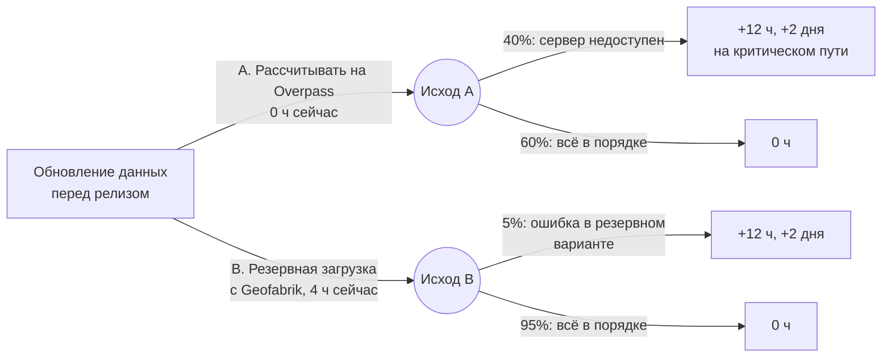

# Лабораторная работа №4
## Риски, качество и организация разработки

Вход: утверждённый базовый план (`v0.3-plan`): оценки, сетевой график, календарный план, бюджет с резервами, план коммуникаций, спланированный Sprint 1. Реестр рисков из устава.
Выход: реестр рисков с количественным анализом, проверка правовых и этических рисков, план управления качеством, правила работы с репозиторием, автопроверка качества (CI), выполненный Sprint 1 с обзором, ретроспективой и статус-отчётом, релиз `v0.4`.

---

## 1. О чём эта работа

Базовый план из ЛР 3 отвечает на вопрос «как всё пойдёт, если всё пойдёт по плану». На практике так почти не бывает: данные оказываются хуже, чем казалось, кто-то болеет, заказчик что-то меняет, а ошибка в расчёте может попасть в отчёт. В этой работе команда готовится к тому, что пойдёт не так, и начинает разработку.

Работа состоит из трёх частей:
- **Риски.** Вы пересмотрите реестр рисков, оцените, с какой вероятностью проект успевает в срок с учётом рисков, и выберете ответ на один из рисков с помощью дерева решений. Отдельно проверите правовые и этические вопросы: лицензии данных, персональные данные, смещение выводов.
- **Качество.** Вы договоритесь, что команда считает качественным результатом, как это проверяется, и переложите часть проверок на автоматику: правила ветки `main`, обязательное ревью, автопроверку кода и данных в GitHub Actions.
- **Sprint 1.** Вы выполните первый спринт по плану ЛР 3, проведёте обзор и ретроспективу, напишете первый настоящий статус-отчёт и выпустите релиз `v0.4`.

Главная мысль работы: риски и качество не отдельные документы «для сдачи», а то, что меняет план и ежедневную работу. Если после анализа рисков в плане ничего не изменилось, анализ сделан впустую.

**К концу работы вы сможете:**
- описывать риски в формате «причина → событие → последствие» и выбирать стратегию ответа;
- оценивать вероятность успеть в срок и в бюджет методом Монте-Карло;
- сравнивать варианты ответа на риск с помощью дерева решений и ожидаемой стоимости (EMV);
- находить правовые и этические риски в проекте с открытыми данными;
- составлять план управления качеством с измеримыми метриками;
- настраивать в GitHub правила ветки, шаблон Pull Request, автопроверку качества и релизы с автоматическими заметками;
- проводить обзор спринта, ретроспективу и писать статус-отчёт.

---

## 2. Краткая справка

### Риски

| Термин | Что это простыми словами |
|---|---|
| **Риск** | Неопределённое событие, которое, если произойдёт, повлияет на цели проекта. Риск ещё не случился. То, что уже случилось, — это **проблема** (issue), её решают, а не оценивают. |
| **Угроза и возможность** | Риск бывает негативным (угроза) и позитивным (возможность). Возможности тоже вносят в реестр и ими тоже управляют. |
| **Формат «причина → событие → последствие»** | «Из-за [факт или условие] может произойти [событие], что приведёт к [влияние на срок, бюджет, качество]». Такая формулировка отделяет риск от его причины и показывает, на что он влияет. Плохо: «Данные». Хорошо: «Из-за того, что OSM заполняют добровольцы, часть фонтанчиков может отсутствовать в данных, и выводы о районах окажутся неверными». |
| **Структура рисков (RBS)** | Список категорий, по которым команда «прочёсывает» проект: данные, технологии, команда, заказчик и требования, внешние сервисы, рынок и конкуренты, правовые и этические вопросы. Помогает не забыть целую группу рисков. |
| **Вероятность и влияние** | Оцениваются по шкале 1–5. Чтобы оценки разных людей совпадали, у каждого балла есть описание: например, вероятность 3 — это 30–50%, влияние 4 на срок — больше буфера. Шкала — в `docs/risk-register.md`. |
| **Оценка риска** | Вероятность × влияние, от 1 до 25. Определяет, каким рискам уделять внимание в первую очередь. |
| **Матрица рисков** | Таблица 5 × 5, где по одной оси вероятность, по другой влияние. Риски в правом верхнем углу требуют действий сейчас. |
| **Владелец риска** | Один человек, который следит за риском и запускает ответную меру. Не «команда», а конкретный участник. |
| **Триггер** | Признак того, что риск вот-вот наступит или уже наступает. Например: «в выборочной проверке подтвердилось меньше 80% точек». |
| **Резерв на риски** | Время или деньги в бюджете на известные риски (ЛР 3). Расходуется менеджером по решению, а не «потому что не успели». |
| **Остаточный риск** | Риск, который остаётся после ответной меры. |
| **Вторичный риск** | Новый риск, который появляется из-за самой ответной меры. |

**Стратегии для угроз:**

| Стратегия | Суть | Пример |
|---|---|---|
| **Избежать** | Изменить план так, чтобы риск стал невозможен | Отказаться от источника с непонятной лицензией |
| **Снизить** | Уменьшить вероятность или влияние | Выборочно проверить данные заранее; назначить дублёра по задаче |
| **Передать** | Переложить последствия на третью сторону | Договор, гарантия, платный сервис с SLA. В учебном проекте применяется редко |
| **Принять** | Ничего не делать заранее. Активное принятие — заложить резерв, пассивное — просто наблюдать | Резерв 6 часов на изменение требований |
| **Эскалировать** | Риск вне полномочий команды, его передают спонсору | Заказчик не даёт доступ к данным |

**Стратегии для возможностей:** **использовать** (сделать так, чтобы возможность точно реализовалась), **усилить** (повысить вероятность или выгоду), **разделить** (привлечь того, кто лучше её реализует), **принять** (воспользоваться, если случится).

### Количественный анализ

| Термин | Что это простыми словами |
|---|---|
| **Метод Монте-Карло** | Компьютер тысячи раз «проигрывает» проект: каждый раз длительности работ выбираются случайно в пределах оценок O–P, а риски наступают с заданной вероятностью. По результатам считается, в какой доле прогонов проект укладывается в срок и бюджет. |
| **P50, P85** | Значение, которое не будет превышено с вероятностью 50% или 85%. Если P85 срока — 18 декабря, значит, в 85% прогонов проект закончен не позже этой даты. Спонсору обычно называют P85. |
| **Слияние путей (merge bias)** | Работа, которая ждёт нескольких предшественников, начинается после самого позднего из них. Поэтому реальный срок в среднем позже, чем по одному критическому пути: задержаться может любая из сходящихся веток. Монте-Карло это учитывает, CPM — нет. |
| **Индекс критичности** | В какой доле прогонов работа оказалась на критическом пути. Показывает работы, которые не критические «на бумаге», но часто определяют срок. |
| **Анализ чувствительности** | Насколько сильно колебания отдельной работы или риска влияют на итог. Помогает понять, куда направить ответные меры. |
| **Дерево решений** | Схема выбора: варианты действий, у каждого — возможные исходы с вероятностями и последствиями. |
| **Ожидаемая денежная стоимость (EMV)** | Сумма «затраты + вероятность × последствие» по всем исходам варианта. Выбирают вариант с лучшим EMV, но с оглядкой на худший случай и жёсткие ограничения, например неподвижную дату защиты. |

### Правовые и этические вопросы данных

| Термин | Что это простыми словами |
|---|---|
| **ODbL** | Лицензия OpenStreetMap. Требует указывать авторство и распространять производные базы данных на тех же условиях ([OpenStreetMap](https://www.openstreetmap.org/copyright)). |
| **Производная база данных** | База, полученная изменением или дополнением данных OSM: например, очищенный слой точек с вашими полями или слой OSM, объединённый со списком заказчика. Если её публикуют, она должна распространяться по ODbL ([OSM Wiki](https://wiki.openstreetmap.org/wiki/Open_Data_License/Legal_Structure)). |
| **Произведённая работа** | Результат, который не является базой данных: карта-картинка, отчёт, график. Для неё ODbL требует только указать источник ([OSMF](https://osmfoundation.org/wiki/Licence/Licence_Compatibility)). |
| **Атрибуция** | Подпись об источнике. Для OSM — «© участники OpenStreetMap» со ссылкой на страницу авторских прав, на видном месте карты или рядом с ней ([OSMF, правила атрибуции](https://osmfoundation.org/wiki/Licence/Attribution_Guidelines)). |
| **CC BY 4.0** | Открытая лицензия: можно использовать и изменять, указывая автора. Под ней, например, распространяются данные WorldPop ([WorldPop](https://hub.worldpop.org/data/licence.txt)). |
| **Персональные данные** | По 152-ФЗ — «любая информация, относящаяся к прямо или косвенно определенному или определяемому физическому лицу» ([152-ФЗ, ст. 3](https://www.consultant.ru/document/cons_doc_LAW_61801/4f41fe599ce341751e4e34dc50a4b676674c1416/)). Адрес, фотография с лицом, почта в форме обратной связи, координаты конкретного человека могут быть персональными данными. |
| **Смещение данных** | Данные неравномерно описывают разные территории или группы людей. Например, в центре города OSM заполнен лучше, чем на окраинах. Тогда «мало точек» может означать «мало нанесено на карту», и выводы окажутся несправедливыми к окраинам. |

### Качество

| Термин | Что это простыми словами |
|---|---|
| **Управление качеством** | Договорённость о том, что считать качественным результатом, как это проверять и кто за это отвечает. Делится на **обеспечение качества** (процессы, которые предотвращают ошибки: ревью, правила, автопроверки) и **контроль качества** (проверки готового результата: тесты, приёмка). |
| **Метрика качества** | Измеримый показатель с порогом. «Код хороший» — не метрика. «Все PR прошли автопроверку и ревью» — метрика. |
| **Стратегия тестирования** | Что, каким способом и на каком уровне проверяется. В аналитическом проекте уровни такие: проверка данных, модульные тесты расчётных функций, приёмка историй по критериям, проверка выводов вторым участником. |
| **Модульный (unit) тест** | Маленькая программа, которая вызывает функцию на простых данных с заранее известным ответом и сравнивает результат. Например, точка в 500 м от фонтанчика должна считаться «в доступности 500 м». |
| **Проверка данных** | Автоматическая проверка слоёв: задана ли система координат, нет ли пустых и некорректных геометрий, дубликатов, объектов за пределами города. |
| **Ревью кода** | Проверка изменений другим участником до слияния в `main`. Ищет не только ошибки, но и непонятные места. Ревью — тоже метрика процесса: доля PR с ревью. |
| **Стоимость качества** | Предотвратить ошибку почти всегда дешевле, чем найти, а найти до релиза — дешевле, чем после. Ошибка в цифрах, которую заказчик увидит в отчёте, стоит дороже всего: страдает доверие ко всему продукту. |

### Конфигурация и автоматизация

| Термин | Что это простыми словами |
|---|---|
| **Управление конфигурацией** | Правила, по которым меняются файлы проекта: где лежит актуальная версия, как вносится изменение, как связаны задача, изменение и релиз. |
| **GitHub Flow** | Простая модель ветвления: одна ветка `main` всегда в рабочем состоянии, любая работа идёт в короткой ветке и возвращается в `main` через Pull Request. |
| **Трассируемость** | Возможность пройти цепочку «задача → ветка → коммиты → PR → релиз» в обе стороны. Отвечает на вопросы «почему изменилась эта строка» и «что вошло в релиз». |
| **Правила ветки (rulesets)** | Настройки GitHub, которые запрещают прямые изменения `main`, требуют одобрение ревьюера и успешную автопроверку перед слиянием ([GitHub Docs](https://docs.github.com/en/repositories/configuring-branches-and-merges-in-your-repository/managing-rulesets/available-rules-for-rulesets)). |
| **CI (непрерывная интеграция)** | Автопроверка, которая запускается на каждый PR: стиль кода, тесты, проверка данных. Если она красная, изменение не вливается. |
| **Обязательная проверка (required status check)** | Автопроверка, без успеха которой правила ветки не дают нажать кнопку слияния. |
| **Squash merge** | Способ слияния, при котором все коммиты PR склеиваются в один. История `main` получается короткой: один коммит на задачу. |
| **Релиз с автоматическими заметками** | GitHub сам собирает список влитых PR с момента прошлого релиза и группирует их по меткам ([GitHub Docs](https://docs.github.com/en/repositories/releasing-projects-on-github/automatically-generated-release-notes)). |

---

## 3. Учебный пример: AquaMap Ekaterinburg (продолжение)

В ЛР 3 команда AquaMap утвердила базовый план. Критический путь «проверка полноты → доступность → картограмма → публикация → отчёт» длится 34 рабочих дня, с 26 октября по 11 декабря, буфер — 14–17 декабря, защита — 18 декабря. Ожидаемая трудоёмкость 87,3 часа, резерв на риски 15 часов. Спонсор дал решение «Go с условиями».

С чем команда пришла в ЛР 4:
- **Реестр рисков** из устава: пять рисков. Самый высокий — R1 «неполные данные OSM» (5 × 4 = 20). Он вырос в ЛР 2, когда выяснилось, что полнота точек не проверена.
- **Sprint 1 (26.10–06.11)** спланирован: спайк #41 по проверке полноты (лимит 6 ч), US-7 уточнение жилой застройки (3 SP), US-6 школы без воды в 300 м (5 SP), окружение и автопроверки (6,7 ч), начало веб-карты (3,7 ч). Всего 27,5 часа.
- **Ни одной автопроверки** кроме информационных проверок лабораторных. В `main` можно отправить что угодно, ревью держится на честном слове.

Эта работа совпадает по времени со Sprint 1. Риски и качество команда разбирает в первые дни спринта, пока идёт спайк, а настроенные правила и CI сразу применяет к задачам спринта.

---

## 4. Роли в этой работе

Менеджером проекта становится участник, который ещё не был им. Если менеджерами побывали все, роль возвращается к участнику из ЛР 1.

| Роль | Чем занимается в ЛР 4 |
|---|---|
| Менеджер проекта (новый) | Реестр рисков, Монте-Карло и дерево решений, обзор спринта, статус-отчёт, релиз |
| Владелец продукта | Цель и приёмка Sprint 1, порядок бэклога, решения по изменениям |
| Ответственный за качество | План качества, тесты расчётных функций, правила проверки данных, чек-лист ревью |
| Технический лидер | Правила ветки, CONTRIBUTING.md, CI, шаблоны, метки и релизы |

Правовые и этические вопросы (шаг 3) берёт любой участник, лучше тот, у кого меньше задач в спринте.

В группе из 2–3 человек роли совмещаются. Удобно так: менеджер + владелец продукта, ответственный за качество + технический лидер. В примере AquaMap менеджер в ЛР 4 — Анна (в ЛР 1 и 2 менеджером был Иван, в ЛР 3 — Олег). Владелец продукта и ответственный за качество — Олег, технический лидер — Иван. Правовыми вопросами занимается Анна.

Правила прежние: нет задачи — нет работы, всё в `main` через Pull Request с ревью, использование ИИ записывается в `docs/ai-usage.md`. С этой работы первые два правила будет проверять не только команда, но и GitHub.

---

## 5. Пошаговое задание

### Шаг 0. Подготовка репозитория и передача дел (20 минут)

**Обновите репозиторий** из шаблона так же, как в ЛР 3:

```bash
git fetch template
git switch -c chore/lab4-files
git checkout template/main -- docs/risk-register.md docs/quality-plan.md \
  docs/tasks/lab-4-assignment.md CONTRIBUTING.md pyproject.toml requirements-dev.txt \
  src tests scripts data/validation.json notebooks/05_risk_monte_carlo.ipynb notebooks/README.md \
  .github/workflows .github/scripts .github/release.yml \
  .github/ISSUE_TEMPLATE/bug.md .github/pull_request_template.md
git commit -m "chore: add lab 4 files from template"
git push -u origin chore/lab4-files
```

Если удалённый репозиторий `template` ещё не добавлен, сначала выполните `git remote add template https://github.com/aydarabdullin/pm-lab-template.git`. Затем создайте Pull Request и влейте его. Обратите внимание: в этом PR уже запустится новая проверка `ci`. Если в `data/processed` лежат слои, она проверит их по правилам шаблона, которые написаны для AquaMap. Красный результат на этом этапе нормален: правила под свой проект вы настроите в шаге 6.

**Подготовьте трекер.** Запустите **Actions → Bootstrap: метки, этап и стартовые задачи → Run workflow** с номером **4**. Появятся этап «ЛР4: Риски и качество», метки `bug`, `quality`, `ci` и стартовые задачи. Задачи Sprint 1 у вас уже есть с ЛР 3.

**Передайте дела.** Прежний менеджер рассказывает новому, какие условия поставил спонсор на контрольной точке ЛР 3 и что открыто в Sprint 1. Обновите таблицу ролей в README.

---

## Часть А. Риски

### Шаг 1. Обновите реестр рисков (50–60 минут)

#### Что сделать

1. **Перенесите риски** из устава в `docs/risk-register.md` и перепишите их в формате «причина → событие → последствие».
2. **Найдите новые риски.** Пройдите по категориям RBS: данные, технологии, команда, заказчик и требования, внешние сервисы, рынок и конкуренты, правовые и этические вопросы. Не ограничивайтесь внутренними рисками. Спросите себя, что будет, если похожее решение появится у заказчика раньше вашего. Используйте то, что уже узнали: проблемы качества данных из ЛР 2, самые неопределённые оценки и критический путь из ЛР 3. Итого не меньше 8 рисков и хотя бы одна возможность.
3. **Оцените** вероятность и влияние по шкалам из раздела 1 реестра. Сначала каждый участник ставит оценку молча, затем расхождения больше чем на 1 балл обсуждаются, как в Planning Poker.
4. **Для каждого риска** запишите стратегию, ответную меру, триггер и владельца. Ответная мера должна быть действием, которое можно завести задачей, а не пожеланием «быть внимательнее».
5. **Привяжите резерв.** Резерв на риски из `docs/budget.md` (ЛР 3) распределите по рискам: какие часы на что. Если на высокий риск резерва нет, это повод его пересмотреть.
6. **Заведите ответные меры задачами** с меткой `risk` и добавьте их в Sprint 1 или 2. Риски с оценкой 15 и выше обязательно должны иметь задачу.
7. **Заполните матрицу** номерами рисков.

#### Как это сделала команда AquaMap

Анна провела встречу на 40 минут. Каждый получил 10 минут, чтобы молча выписать риски по категориям, затем всё объединили и убрали повторы. Из десяти кандидатов один оказался проблемой, а не риском: «в OSM колодцы отмечены как питьевые точки» — это уже известный факт из ЛР 2, он решён правилом очистки. В реестр он не попал.

| № | Категория | Причина → событие → последствие | В | Вл | Оценка | Стратегия | Ответная мера | Триггер | Владелец | Резерв |
|---|---|---|---|---|---|---|---|---|---|---|
| R1 | Данные | Из-за того, что OSM заполняют добровольцы, часть фонтанчиков может отсутствовать или устареть, и выводы о районах окажутся неверными | 5 | 4 | **20** | Снизить | Спайк #41: 30 случайных точек сверить по снимкам; оговорка о полноте в отчёте | В проверке подтверждено меньше 80% точек | Олег | 6 ч |
| R2 | Команда | Из-за болезни или сессии участник может выпасть на неделю, и работа на критическом пути встанет | 2 | 4 | 8 | Снизить | Анна — дублёр по доступности (2.2): разбирает ноутбук вместе с Олегом в Sprint 1 | Участник не отвечает в чате 2 дня | Анна | — |
| R3 | Заказчик | Из-за того, что заказчик увидит первые результаты, он может изменить требования к рекомендациям, и часть работы придётся переделать | 3 | 3 | 9 | Принять активно | Резерв 6 ч; изменения только через запрос на изменение (ЛР 5) | Новое требование вне MVP на обзоре | Олег | 6 ч |
| R4 | Правовые | Из-за ошибки в выборе источника данные могут оказаться несовместимы с публикацией, и карту нельзя будет показать | 1 | 5 | 5 | Избежать | Источник DS-04 отклонён в ЛР 2; лицензии проверяются до использования источника (шаг 3) | Новый источник без лицензии в `data/sources.md` | Анна | — |
| R5 | Данные | Из-за того, что в OSM не у всех домов указан тип, часть жилых зданий может не попасть в расчёт, и доля домов в доступности будет искажена | 4 | 3 | 12 | Снизить | US-7 в Sprint 1: сравнить число зданий со статистикой, добавить недостающие типы | Расхождение со статистикой больше 15% | Олег | — |
| R6 | Внешние сервисы | Из-за того, что публичный сервер Overpass бесплатный и бывает перегружен, финальное обновление данных перед релизом может не выполниться, и выпуск задержится | 3 | 3 | 9 | Снизить | Резервная загрузка с Geofabrik (решение по дереву, шаг 2) | Два запроса подряд завершились ошибкой | Иван | — |
| R7 | Этические | Из-за того, что окраины размечены в OSM хуже центра, низкие показатели окраинных районов могут отражать полноту данных, а не реальную ситуацию, и рекомендации будут несправедливыми | 3 | 4 | 12 | Снизить | В спайке #41 выбрать точки отдельно для центра и окраин; показывать полноту по районам рядом с показателем | Доля подтверждённых точек в центре и на окраинах различается больше чем на 15 п. п. | Анна | — |
| R8 | Технологии | Из-за того, что расчёты пишутся в ноутбуках без проверок, ошибка в расчёте может попасть в отчёт заказчику | 3 | 4 | 12 | Снизить | Тесты расчётных функций, проверка данных и обязательное ревью в CI (шаги 4–6) | PR влит без ревью или с красной проверкой | Иван | — |
| R9 | Рынок и конкуренты | Из-за того, что данные OSM открыты, а тема питьевой воды в городе на слуху, другая команда или компания может раньше предложить департаменту готовое решение, и заказчик откажется от нашего продукта или от его части | 2 | 4 | 8 | Снизить | Обзор существующих решений (#62); раннее демо аналитики заказчику на обзоре Sprint 2, а не в конце; фокус на том, чего нет в общих картах: показатели по районам и рекомендации | Заказчик упоминает другое решение; появилась публикация о похожем сервисе для города | Олег | — |
| | | Неточность оценок | | | | Принять активно | — | — | Анна | 3 ч |

| № | Причина → событие → выгода | В | Вл | Оценка | Стратегия | Мера | Владелец |
|---|---|---|---|---|---|---|---|
| O1 | Из-за того, что у департамента есть свой перечень обслуживаемых фонтанчиков, он может передать его команде, и полнота точек станет известна | 2 | 4 | 8 | Усилить | Официальный запрос через спонсора с объяснением, зачем нужен перечень | Олег |

Матрица:

| Вероятность \ Влияние | 1 | 2 | 3 | 4 | 5 |
|---|---|---|---|---|---|
| **5** | | | | R1 | |
| **4** | | | R5 | | |
| **3** | | | R3, R6 | R7, R8 | |
| **2** | | | | R2, R9, O1 | |
| **1** | | | | | R4 |

**Что изменилось по сравнению с уставом.**
- R4 снижен с 2 × 5 = 10 до 1 × 5 = 5: источник с плохой лицензией отклонён ещё в ЛР 2. Это пример стратегии «избежать»: риск не уменьшен, а устранён изменением плана.
- R6, R7, R8 и R9 новые. R7 появился из выводов ЛР 2: разброс доли домов в доступности между Ленинским (около 80%) и Железнодорожным (около 6%) районами слишком велик, чтобы списать его только на реальность.
- R9 добавил Олег как владелец продукта. Готовая карта фонтанчиков может появиться у городского портала, картографического сервиса или у команды на городском хакатоне. Если она закроет потребность департамента, выгода от AquaMap упадёт, а в ЛР 3 запас прочности небольшой: уже при выгоде 120 000 руб. в год вместо 150 000 NPV становится отрицательным. Влияние 4: заказчик может выбрать другое решение для основной задачи. Вероятность 2: общие карты обычно показывают точки, но не считают доступность по районам и не дают рекомендаций, а это главное, что нужно департаменту.
- Ответная мера по R9 — не «сделать быстрее всех», а показать ценность раньше и в том, в чём AquaMap отличается. Если риск наступит, план такой: сравнить решения на обзоре с заказчиком, при подходящей лицензии взять данные конкурента как ещё один источник для проверки полноты, а работу сосредоточить на аналитике по районам. R9 не выражается в днях, поэтому в модель Монте-Карло (шаг 2) он не входит. Его последствия видны в расчёте окупаемости.
- Олег заметил, что R1 и R7 решаются одной задачей: спайк #41 нужно делать не по 30 случайным точкам города, а по 15 в центральных районах и 15 на окраинах. Описание спайка поменяли до его начала.

**Задачи.** По R1 уже есть спайк #41. Новые задачи: #52 «Дублёр по доступности» (R2), #53 «Резервная загрузка с Geofabrik» (R6, после решения в шаге 2), #54 «Полнота по районам в отчёте» (R7), #62 «Обзор существующих решений» (R9). R8 закрывается задачами шагов 4–6.

**Результат шага:** `docs/risk-register.md`, разделы 1–4; задачи с меткой `risk` на доске.

---

### Шаг 2. Оцените риски количественно: Монте-Карло и дерево решений (50–60 минут)

#### Что сделать

1. **Откройте** `notebooks/05_risk_monte_carlo.ipynb` в Colab (приложение В). Таблица работ в нём такая же, как в ноутбуке 04: перенесите свои работы, оценки O, M, P, длительности и зависимости из ЛР 3.
2. **Выберите 3–5 рисков**, которые можно выразить в днях и часах, и задайте для каждого: работу, на которую он влияет, вероятность, дни задержки и дополнительные часы. Задайте два набора значений: до ответных мер и после них.
3. **Запустите ноутбук** и перенесите в раздел 5 реестра таблицу трёх сценариев, график, индекс критичности и влияние рисков.
4. **Ответьте на вопросы:** с какой вероятностью проект успевает к сроку и к концу буфера? Хватает ли резерва часов? Какие работы и риски сильнее всего влияют на срок? Если вероятность успеть к концу буфера ниже 80%, что команда меняет в плане?
5. **Постройте дерево решений** для одного риска, где есть выбор между двумя-тремя вариантами действий. Посчитайте EMV в ноутбуке (раздел 6) и запишите решение с обоснованием.
6. **Внесите решения в план:** новые задачи, изменения в спринтах, перераспределение резерва.

Вероятности рисков — экспертные оценки, а не факты. Не стремитесь к точности: модель нужна, чтобы сравнить сценарии и найти слабые места плана, а не чтобы предсказать дату с точностью до дня.

#### Как это сделала команда AquaMap

**Риски в модели.** Анна выбрала четыре риска, которые влияют на работы критического пути или рядом с ним:

| Риск | Работа | Вероятность до / после мер | Дни до / после | Часы до / после | Что за ответной мерой |
|---|---|---|---|---|---|
| R1 Повторная проверка данных | 1.5 | 0,5 / 0,2 | 3 / 3 | 6 / 6 | Спайк заранее находит проблему, повторная проверка нужна реже |
| R2 Участник выпадает на неделю | 2.2 | 0,2 / 0,2 | 5 / 2 | 0 / 2 | Дублёр снижает не вероятность, а последствия |
| R3 Изменение требований | 4.1 | 0,3 / 0,3 | 2 / 2 | 6 / 6 | Активное принятие: только резерв |
| R6 Overpass недоступен | 5.2 | 0,4 / 0,05 | 2 / 2 | 12 / 12 | Резервный источник (дерево решений ниже) |

**Результаты, 10 000 прогонов:**

| Сценарий | P(до 11.12) | P(до 17.12) | Срок P50 | Срок P85 | Часы P50 | Часы P85 | P(часы ≤ 102,3) |
|---|---|---|---|---|---|---|---|
| Только неопределённость оценок | 38% | 81% | 15.12 | 18.12 | 87,0 | 93,4 | 99% |
| Оценки и риски до ответных мер | 15% | 50% | 18.12 | 24.12 | 96,7 | 107,3 | 71% |
| Оценки и риски после ответных мер | 27% | 69% | 16.12 | 22.12 | 91,0 | 99,2 | 92% |

Команда обратила внимание на три вещи.

1. **Даже без рисков проект успевает к 11 декабря только в 38% случаев.** Срок 34 дня по CPM считается по наиболее вероятным длительностям, а в оценках пессимистичный вариант далеко от наиболее вероятного: задержки бывают больше, чем ускорения. К этому добавляется слияние путей: картограмма ждёт и карту, и показатели, и доступность. Поэтому буфер в ЛР 3 был заложен не зря. С ним вероятность 81%.
2. **Без ответных мер проект укладывается в буфер только в половине случаев**, а P85 — 24 декабря, позже защиты. Часов из резерва хватает в 71% прогонов. Это убедительный аргумент для спонсора, зачем тратить время на спайк и дублёра.
3. **Даже после ответных мер P85 — 22 декабря**, тоже после защиты. Нужна ещё одна мера.

**Что сильнее всего влияет на срок.** Индекс критичности: доступность (2.2) и проверка полноты (1.5) — 84%, картограмма (3.2) и публикация (5.2) — 71%, отчёт (6.3) — 100%. Рекомендации (4.1), не критические по CPM, оказываются на критическом пути в 29% прогонов. Из рисков сильнее всего сдвигает финиш R2: в среднем на 4,6 дня, если наступил, затем R1 — на 2,5 дня и R6 — на 1,6 дня.

**Дополнительная мера.** Последняя работа, итоговый отчёт (6.3), лежит на критическом пути всегда и занимает 5 дней. Анна предложила писать отчёт по ходу проекта: в Definition of Done каждой истории добавлен пункт «абзац с выводом и ограничениями добавлен в черновик отчёта». Часы не меняются, но длительность финальной работы сокращается до 3 дней. Команда перезапустила ноутбук с этим изменением: в сценарии после ответных мер вероятность уложиться в буфер выросла до 84%, P85 — 18 декабря. Это впритык к защите, поэтому Анна записала правило: буфер расходуется только по её решению, о каждом дне буфера сообщается спонсору.

**Дерево решений для R6.** Перед финальным релизом нужно один раз обновить данные. Есть два варианта:



| Вариант | Затраты сейчас | EMV, ч | Ожидаемая задержка | Худший случай |
|---|---|---|---|---|
| A. Рассчитывать на Overpass | 0 ч | 0,4 × 12 = **4,8** | 0,8 дня | 12 ч и 2 дня |
| B. Резервная загрузка с Geofabrik | 4 ч | 4 + 0,05 × 12 = **4,6** | 0,1 дня | 16 ч и 2 дня |

По часам варианты почти равны. Решили выбрать B, потому что он защищает срок: ожидаемая задержка на критическом пути в 8 раз меньше, а дату защиты сдвинуть нельзя. Вывод для отчёта: EMV — не единственный критерий. Когда одно из ограничений жёсткое, вариант оценивают и по нему. Худший случай у B хуже на 4 часа, и команда сознательно это приняла.

Задача #53 «Резервная загрузка с Geofabrik» (4 ч) поставлена в Sprint 2. Откуда взять часы, решили на обзоре Sprint 1, когда станет известен результат спайка (шаг 8).

**Вывод для спонсора:** «С учётом рисков и ответных мер проект завершится до конца буфера с вероятностью около 84%. Главные угрозы сроку — проверка полноты данных и выпадение участника на работе с доступностью. По обеим приняты меры».

**Результат шага:** раздел 5 реестра рисков, график `docs/img/monte_carlo.png`, задачи на ответные меры, изменённый DoD.

---

### Шаг 3. Проверьте правовые и этические риски (30–40 минут)

#### Что сделать

1. **Лицензии.** Для каждого источника из `data/sources.md` выпишите: лицензию, что она разрешает и что требует. Особенно внимательно — что будет, если вы объедините данные из разных источников и опубликуете результат.
2. **Атрибуция.** Проверьте, что подпись об источнике есть везде, где показываются данные: на веб-карте, на статичных картах, в README, в отчёте.
3. **Производные данные.** Решите, под какой лицензией лежат файлы в `data/processed/` и что будет, если вы передадите их заказчику или откроете репозиторий. Код и данные могут иметь разные лицензии.
4. **Персональные данные.** Проверьте, есть ли они в ваших данных или могут ли появиться: поля с именами и телефонами, адреса частных лиц, фотографии людей, форма обратной связи, учёт посетителей карты. Если могут — что вы делаете: убираете поля, отказываетесь от функции или переносите её за пределы MVP.
5. **Смещение данных.** Подумайте, кого или какую территорию ваши данные описывают хуже. Как это влияет на выводы и как вы об этом сообщите заказчику.
6. **Заполните раздел 6** реестра. Найденные риски добавьте в реестр, действия — задачами.

Этот шаг не юридическая экспертиза. Ваша задача — заметить вопросы и принять осознанные решения. Спорные случаи записывайте как вопрос к заказчику.

#### Как это сделала команда AquaMap

| Вопрос | Что у нас | Что делаем | Где зафиксировано |
|---|---|---|---|
| Лицензии источников | DS-01 OSM — ODbL 1.0. DS-02 численность населения — официальная публикация без явной лицензии. DS-03 WorldPop — CC BY 4.0, в MVP не используется | Для каждого источника в `data/sources.md` записаны требования лицензии | `data/sources.md` |
| Атрибуция | Веб-карта, статичные карты, отчёт | На веб-карте в подписи Leaflet «© участники OpenStreetMap» со ссылкой на страницу авторских прав (NFR-03). На PNG-картах подпись в углу. В README — раздел «Источники данных» | README, ноутбук 03, NFR-03 |
| Производная база данных | Очищенные слои в `data/processed/` — производная база данных OSM. Репозиторий публичный (шаг 5), значит, она опубликована | В `data/README.md` указано: «Данные в `data/processed/` получены из OpenStreetMap и распространяются по лицензии ODbL 1.0». Код проекта под лицензией MIT. Карта-картинка и отчёт — произведённая работа, для них достаточно атрибуции | `data/README.md`, файл `LICENSE` |
| Данные заказчика (O1) | Если департамент передаст свой перечень, команда объединит его с OSM | Объединённый слой станет производной базой OSM, и при публикации на него распространится ODbL. Это нужно согласовать с департаментом до объединения. Записано вопросом к заказчику #55 и ADR после ответа | Issue #55 |
| Возврат исправлений в OSM | В спайке найдены фонтанчики, которых нет в OSM | Наносить в OSM можно только то, что проверено на месте или по снимкам, разрешённым для OSM. Переносить данные с Яндекс Карт, Google Maps и их панорам нельзя ([OSM Wiki](https://wiki.openstreetmap.org/wiki/Don't_copy_from_other_maps)). Решили не править OSM в рамках проекта, а передать список департаменту | `docs/data-quality.md` |
| Персональные данные | В слоях OSM нет полей о людях, команда загружает только нужные теги. Олег предлагал добавить историю «сообщить о неработающем фонтанчике» с полем e-mail | E-mail — персональные данные. Для формы нужны согласие на обработку и политика конфиденциальности, это вне MVP. История записана как Won't в этой версии с этой причиной. Карта не собирает данные посетителей: статичная страница на GitHub Pages без счётчиков | `docs/requirements.md`, раздел «Вне границ» |
| Смещение данных | Полнота OSM в центре выше, чем на окраинах (R7) | Спайк по центру и окраинам отдельно; полнота показывается рядом с показателем района; в выводах формулировки «по данным OSM» | R7, `docs/data-quality.md` |
| Использование ИИ | ИИ помогал с черновиками и кодом | Всё записано в `docs/ai-usage.md`; в запросы не вставлялись данные заказчика | `docs/ai-usage.md` |

Анна отдельно проверила историю «сообщить о неработающем фонтанчике». Казалось бы, это мелочь, а на деле она тянет за собой обработку персональных данных по 152-ФЗ, хранение обращений и ответственность оператора данных. Для учебного проекта на 14 недель это несоразмерно. Решение записано в `docs/requirements.md` с причиной, чтобы на обзоре не пришлось объяснять заново.

**Результат шага:** раздел 6 реестра рисков, обновлённые `data/sources.md`, `data/README.md`, README и `LICENSE`, вопросы к заказчику задачами.

---

## Часть Б. Качество

### Шаг 4. Составьте план управления качеством (40 минут)

#### Что сделать

1. **Определите, что такое качество для заказчика.** Свяжите план с нефункциональными требованиями из ЛР 2 и с критериями приёмки историй.
2. **Задайте метрики** в четырёх областях: код, данные, продукт, процесс. У каждой — порог, способ измерения, частота и ответственный. По 2–3 метрики на область достаточно.
3. **Опишите стратегию тестирования** по уровням: что проверяется автоматически, что вручную, что не проверяется совсем и почему.
4. **Составьте чек-лист ревью PR.** Короткий, 8–12 пунктов, каждый проверяется ответом «да» или «нет».
5. **Обновите Definition of Done:** добавьте в него пункты качества, которые раньше держались на честном слове.

#### Как это сделала команда AquaMap

**Метрики и пороги** (фрагмент `docs/quality-plan.md`):

| Область | Метрика | Порог | Как измеряем | Когда | Кто |
|---|---|---|---|---|---|
| Код | Автопроверка `ci / quality` на PR | 100% PR зелёные перед слиянием | Правило ветки `main` | Каждый PR | Иван |
| Код | Расчётные функции с тестами | Каждая функция в `src/`, которая влияет на цифры для заказчика, имеет хотя бы 1 тест с известным ответом | Ревью | Каждый PR | Олег |
| Данные | Корректность слоёв | 0 пустых и некорректных геометрий, 0 дубликатов, CRS задана, объекты в границах города | `scripts/validate_data.py` | Каждый PR | Олег |
| Данные | Достоверность точек | Подтверждено не меньше 80% точек выборки, отдельно в центре и на окраинах | Спайк #41, повтор перед релизом v1.0 | Sprint 1, Sprint 4 | Олег |
| Данные | Свежесть | Данные загружены не раньше чем за 30 дней до релиза | Дата в `_download_log.json` | Перед релизом | Иван |
| Продукт | Скорость карты (NFR-01) | Меньше 3 с в режиме «Slow 4G» | Lighthouse | Каждый релиз с картой | Иван |
| Продукт | Воспроизводимость (NFR-04) | Весь расчёт повторяется за 15 минут | Прогон ноутбуков участником, который их не писал | Перед v0.6-mvp и v1.0 | Анна |
| Процесс | Доля PR с ревью | 100% | Правило ветки `main`, история PR | Обзор спринта | Анна |
| Процесс | Ошибки, найденные после слияния | Не больше 1 за спринт | Задачи с меткой `bug` | Обзор спринта | Анна |

**Стратегия тестирования:**

| Уровень | Что проверяем | Инструмент | Автоматически? |
|---|---|---|---|
| Проверка данных | Структура слоёв: CRS, геометрия, дубликаты, границы, минимальное число объектов | `scripts/validate_data.py` | Да, в CI |
| Модульные тесты | Функции расчёта: расстояния, доли, перепроецирование | `pytest`, `tests/` | Да, в CI |
| Приёмка историй | Критерии «Дано / Когда / Тогда» каждой истории | Ревью и обзор спринта | Нет, владелец продукта |
| Проверка выводов | Цифры в отчёте совпадают с ноутбуком, формулировки привязаны к данным | Второй участник прогоняет ноутбук | Нет |

**Что не тестируем:** сами ноутбуки целиком в CI не запускаются. Им нужен Google Диск и загрузка данных из интернета, а это делает проверку медленной и ненадёжной. Вместо этого расчёты, от которых зависят цифры для заказчика, Олег вынес в `src/geo_utils.py`, и тесты проверяют их. Ноутбук только вызывает функции.

**Чек-лист ревью** (фрагмент):
- [ ] PR связан с задачей (`Closes #N`), ветка названа по правилам
- [ ] Автопроверка зелёная
- [ ] Расстояния и площади считаются в метрической проекции
- [ ] Новые фильтры данных объяснены в коде или в `docs/data-quality.md`
- [ ] У новой расчётной функции есть тест, и тест не повторяет код функции, а проверяет известный ответ
- [ ] Цифры в документе совпадают с выводом ноутбука
- [ ] Выводы сформулированы «по данным OSM», а не как абсолютный факт
- [ ] Использование ИИ записано

**Добавлено в Definition of Done:** «автопроверка зелёная», «у новой расчётной функции есть тест», «абзац с выводом и ограничениями добавлен в черновик отчёта» (из шага 2).

**Результат шага:** `docs/quality-plan.md`, обновлённый `docs/definition-of-done.md`.

---

### Шаг 5. Настройте правила работы с репозиторием (40 минут)

#### Что сделать

1. **Согласуйте `CONTRIBUTING.md`.** В шаблоне уже описаны путь изменения, именование веток и коммитов, правила для данных и ноутбуков, релизы. Прочитайте вместе, поправьте под свою команду, удалите пометку TODO.
2. **Включите правила ветки `main`** (приложение А): изменения только через PR, 1 одобрение, снятие одобрения после новых коммитов, закрытые обсуждения, обязательная проверка `quality`, запрет force push и удаления, линейная история. В **Settings → General → Pull Requests** оставьте только **Allow squash merging** и включите **Automatically delete head branches**.
3. **Проверьте правила.** Попробуйте отправить коммит напрямую в `main`: GitHub должен отказать. Сделайте снимок экрана или скопируйте сообщение об ошибке в описание задачи.
4. **Работайте от задач.** Ветки для задач Sprint 1 создавайте прямо из Issue: справа **Development → Create a branch** ([GitHub Docs](https://docs.github.com/en/issues/tracking-your-work-with-issues/using-issues/creating-a-branch-for-an-issue)). Так ветка сразу связана с задачей.
5. **Проверьте метки.** Категории в `.github/release.yml` строятся по меткам PR. Договоритесь, кто ставит метку: автор PR при создании.

**Сначала сделайте репозиторий публичным.** На бесплатном тарифе GitHub правила ветки работают только в публичных репозиториях. В приватных они доступны лишь на платных тарифах ([GitHub Docs](https://docs.github.com/en/repositories/configuring-branches-and-merges-in-your-repository/managing-protected-branches/about-protected-branches)). Поэтому в курсе репозитории проектов публичные. Перед сменой видимости пройдите короткую проверку, её результат запишите в задачу:

- [ ] в репозитории и в истории коммитов нет паролей, токенов и ключей доступа. Если они когда-то попадали в коммит, этот ключ нужно отозвать и выпустить новый: удаление файла из истории не спасает;
- [ ] нет персональных данных: телефонов, адресов и почты реальных людей, кроме логинов GitHub участников;
- [ ] нет закрытых данных заказчика и материалов, переданных «только для команды»;
- [ ] данные в `data/processed/` можно публиковать по их лицензиям, а лицензия указана в `data/README.md` (шаг 3);
- [ ] в `docs/ai-logs/` и протоколах встреч нет лишнего;
- [ ] в корне есть файл `LICENSE` с лицензией кода (шаг 3).

Затем: **Settings → General → Danger Zone → Change visibility → Change to public** и подтвердите.

Публичный репозиторий увидят и другие группы. Это нормально: история коммитов, задачи и ревью показывают, кто и когда сделал работу, поэтому авторство легко подтвердить. Копировать чужие документы без ссылки нельзя, а ссылаться на удачные решения других групп можно.

#### Как это сделала команда AquaMap

Иван — владелец репозитория. Перед сменой видимости Анна прошла чек-лист и нашла одну проблему: в протоколе интервью из ЛР 1 был записан рабочий телефон сотрудника департамента. Телефон заменили на должность. Ключей и паролей в истории не оказалось. После этого Иван сделал репозиторий публичным и включил правила. Решение и чек-лист записаны в `docs/adr/ADR-004-public-repository.md`.

Протокол с телефоном остался в старых коммитах. Команда решила, что номер служебный и уже указан на сайте департамента, поэтому историю не переписывала, но записала это в ADR. Если бы это был личный номер, пришлось бы удалять его из истории и просить GitHub очистить кэш.

Набор правил `main-protection`:
- **Restrict deletions**, **Block force pushes**;
- **Require a pull request before merging**: 1 одобрение, **Dismiss stale pull request approvals when new commits are pushed**, **Require conversation resolution before merging**, разрешён только squash;
- **Require status checks to pass before merging**: проверка `quality`;
- **Require linear history**.

Список обхода (bypass list) Иван оставил пустым, в том числе для себя. Так владелец репозитория не может случайно отправить изменение в `main` в обход ревью.

Проверка: Олег попробовал отправить исправление опечатки прямо в `main`:

```text
remote: error: GH013: Repository rule violations found for refs/heads/main.
remote: - Changes must be made through a pull request.
remote: - Required status check "quality" is expected.
```

Опечатку исправили через PR `docs/58-fix-typo`. Это заняло на 3 минуты больше, но теперь у каждой строки в `main` есть ревьюер.

**Что поменяли в CONTRIBUTING.md:**
- для ветки отчёта добавили тип `report`;
- договорились, что Draft PR открывается в первый день работы над задачей, чтобы видеть прогресс без вопросов в чате.

**Результат шага:** согласованный `CONTRIBUTING.md`, публичный репозиторий, ADR с чек-листом, включённые правила ветки, подтверждение, что прямой push не проходит.

---

### Шаг 6. Настройте автопроверку качества в GitHub Actions (50–60 минут)

#### Что сделать

В шаблоне уже есть workflow `.github/workflows/ci.yml` с заданием `quality`. На каждый PR в `main` он:
1. проверяет стиль и типичные ошибки кода в `src/`, `tests/`, `scripts/` (ruff);
2. запускает тесты из `tests/` (pytest);
3. проверяет слои в `data/processed/` по правилам из `data/validation.json`;
4. проверяет, что ноутбуки сохранены без вывода ячеек.

Ваша задача — настроить его под свой проект:

1. **Настройте правила данных.** В `data/validation.json` опишите свои слои: имя файла, тип геометрии, минимальное число объектов, поле идентификатора, обязательные поля, границы территории (bbox).
2. **Вынесите расчётные функции.** Найдите в ноутбуке 03 расчёты, от которых зависят цифры для заказчика, и перенесите их в `src/` (пример — `src/geo_utils.py`). В ноутбуке вызывайте функции оттуда. Для Colab положите копию папки `src/` в папку проекта на Google Диске (приложение Б).
3. **Напишите не меньше трёх своих тестов** в `tests/`. Хороший тест проверяет известный ответ на простых данных: точка в 300 м внутри зоны 500 м, точка в 600 м вне её, пустой слой не ломает расчёт.
4. **Сделайте проверку обязательной** в правилах ветки (шаг 5).
5. **Покажите, что CI работает.** Найдите или специально создайте PR, который проверка остановила, и исправьте его. Ссылку на красный и затем зелёный запуск сохраните в задаче.
6. **Добавьте значок статуса** в README: ``.

Проверку можно запускать и у себя до PR (приложение Б).

#### Как это сделала команда AquaMap

**Правила данных.** Иван оставил правила шаблона, они как раз написаны для AquaMap: пять слоёв, CRS EPSG:4326, границы Екатеринбурга с запасом, минимальные числа объектов чуть ниже фактических. На текущих данных проверка прошла:

```text
OK      boundary
OK      districts
OK      water_points
OK      parks
OK      residential

Слоёв с ошибками: 0 из 5
```

**Расчётные функции.** Олег вынес в `src/geo_utils.py` три функции: перевод в метрическую проекцию, расстояние до ближайшей точки, доля объектов в пределах расстояния. Функции сами отказываются считать расстояния в градусах: если слой не в метрах, они выдают ошибку с подсказкой. К шести тестам шаблона Олег добавил три своих для истории про школы.

**Где CI сработал в Sprint 1.**

1. **Ошибка в расчёте.** Анна в PR #60 по US-6 добавила функцию `schools_without_water()`. Тест на неё по правилу из плана качества написал не автор, а Олег: школа в 400 м от фонтанчика не должна считаться «в 300 м». Тест упал:
   ```text
   FAILED tests/test_schools.py::test_school_400m_is_not_covered - assert True is False
   ```
   Причина — тот самый буфер в градусах. Функция строила `buffer(300)` в EPSG:4326, а 300 градусов покрывают всю планету, поэтому все школы оказывались «с водой». Анна добавила `to_metric()`, тест прошёл. Без теста в отчёт ушла бы цифра «100% школ рядом с водой».
2. **Ошибка в данных.** Олег по US-7 добавил в жилую застройку новые типы зданий. Проверка данных упала: `ОШИБКА  residential: лишние типы геометрии: Point`. Часть зданий в OSM нанесена точкой, а не контуром. Олег отфильтровал точки и записал это в `docs/data-quality.md`.
3. **Ноутбук с выводом.** Иван сохранил ноутбук из Colab, не очистив вывод. Проверка показала, в каком файле проблема. Исправление заняло минуту.

Олег записал в задачу по R8: за первый спринт CI поймал одну ошибку, которая исказила бы цифры для заказчика. Вероятность R8 команда снизила с 3 до 2.

**Результат шага:** настроенные `data/validation.json` и `src/`, не меньше трёх своих тестов, обязательная проверка, ссылка на PR, который остановил CI, значок в README.

---

## Часть В. Sprint 1

### Шаг 7. Выполните Sprint 1 (весь спринт)

#### Что сделать

Работайте по плану Sprint 1 из ЛР 3, уже по новым правилам:

1. **Каждая задача** → ветка из Issue → Draft PR в первый день → PR с `Closes #N` и меткой → зелёный CI → ревью → squash merge. Задача закрывается автоматически ([GitHub Docs](https://docs.github.com/en/issues/tracking-your-work-with-issues/using-issues/linking-a-pull-request-to-an-issue)).
2. **Синхронизации** проводите по плану коммуникаций, например письменно в чате три раза в неделю: что сделал, что дальше, что мешает. Блокеры записывайте комментарием в задаче.
3. **Записывайте фактические часы** в задачах. Они понадобятся на обзоре и в ЛР 5.
4. **Следите за триггерами рисков.** Если триггер сработал, владелец риска запускает ответную меру и пишет в чат.
5. **Не добавляйте работу в спринт молча.** Новая задача в середине спринта — только по решению владельца продукта и с записью, что из спринта убрано взамен.

#### Как это сделала команда AquaMap

- **Спайк #41.** Олег проверил 30 точек по спутниковым снимкам и панорамам: 15 в центральных районах, 15 на окраинах. Подтвердились 27 из 30 (90%): в центре 14 из 15, на окраинах 13 из 15. Разница меньше порога R7. Попутно в центральных парках нашлись 6 фонтанчиков, которых нет в OSM. Вывод в `docs/data-quality.md`: OSM в целом точен, но неполон. Цифры по районам — нижняя граница. Спайк занял 6 часов, ровно в пределах лимита.
- **US-7.** Число учтённых жилых зданий после добавления новых типов приблизилось к статистике, расхождение меньше 15%. Триггер R5 не сработал.
- **US-6.** Таблица школ без воды в 300 м по районам готова, после исправления, которое нашёл CI.
- **Окружение и CI (5.1).** Готово, но заняло 8,7 часа вместо 6,7: настройка правил и разбор первых красных проверок.
- **Веб-карта (3.1).** Прототип с точками на Leaflet готов примерно на 40%, как и планировалось.
- **Дублёр (R2).** На еженедельной встрече Олег показал Анне ноутбук доступности, Анна записала в задаче, как его запускать.

За спринт влито 11 PR, у всех было ревью, у трёх CI сначала был красным. Прямых коммитов в `main` не было.

**Результат шага:** закрытые задачи Sprint 1, PR со связью с задачами, фактические часы в задачах.

---

### Шаг 8. Проведите обзор, ретроспективу, обновите риски и выпустите релиз (50–60 минут)

#### Что сделать

1. **Обзор спринта** (с преподавателем в роли заказчика, 10–15 минут): цель спринта и достигнута ли она, демонстрация результатов, что принято и что нет. Протокол в `docs/meetings/`.
2. **Ретроспектива** (команда, 20 минут): что помогало, что мешало, 1–2 улучшения. Улучшения заводятся задачами в Sprint 2.
3. **Обновите реестр рисков** по фактам спринта: какие риски изменились, какие новые появились, на что потратили резерв. Запишите изменения в историю реестра.
4. **Заполните результаты** в разделе 6 плана качества: PR, ревью, падения CI, найденные ошибки.
5. **Статус-отчёт №1** по шаблону из плана коммуникаций — Issue с меткой `status`.
6. **Релиз `v0.4`:** **Releases → Draft a new release → Choose a tag** `v0.4` → **Generate release notes**. Проверьте, что все PR попали в нужные категории. В начало заметок добавьте 2–3 предложения о цели спринта и итоге.

#### Как это сделала команда AquaMap

**Обзор.** Цель «Данные проверены, окружение готово, есть показатели по районам и школам» достигнута. Заказчик принял US-6 и US-7, результат спайка вызвал больше всего вопросов. Заказчик попросил показать 6 найденных фонтанчиков отдельным слоем «не нанесены в OSM». Олег как владелец продукта записал это в бэклог как новую историю на оценку в Sprint 2, а не стал добавлять в текущий план.

**Ретроспектива.**
- Помогало: правило «тест пишет не автор функции» нашло реальную ошибку; Draft PR в первый день — меньше вопросов «как дела».
- Мешало: на CI ушло на 2 часа больше плана, в основном на разбор первых падений.
- Улучшения: перед PR запускать проверки у себя (#63); в задачах с данными сразу указывать слой и правило проверки (#64).

**Изменения в реестре:**

| Риск | Было | Стало | Почему |
|---|---|---|---|
| R1 | 5 × 4 = 20 | 3 × 4 = 12 | Спайк подтвердил 90% точек. Остаётся неполнота: в OSM есть не все фонтанчики |
| R5 | 4 × 3 = 12 | 2 × 3 = 6 | US-7 выполнена, расхождение со статистикой меньше 15% |
| R7 | 3 × 4 = 12 | 2 × 4 = 8 | Разница достоверности центра и окраин 6,7 п. п., меньше порога |
| R8 | 3 × 4 = 12 | 2 × 4 = 8 | CI и тесты работают, поймали ошибку в US-6 |
| R9 | 2 × 4 = 8 | 2 × 4 = 8 | Обзор (#62): существующие карты показывают точки, но не считают доступность по районам. На обзоре заказчик подтвердил, что ему нужна именно аналитика. Оценка не изменилась, наблюдение раз в спринт |
| Резерв | R1 — 6 ч | R1 — 2 ч, R6 — 4 ч | После спайка повторная проверка вряд ли понадобится. 4 часа переданы на резервную загрузку с Geofabrik (#53) |

**Статус-отчёт №1.**

```markdown
# Статус-отчёт: Sprint 1 · 06.11.2026

Общий статус: зелёный

| Измерение | Статус | Комментарий |
|---|---|---|
| Сроки | Зелёный | Критический путь по плану: проверка полноты закончена в срок. Буфер не использован |
| Бюджет | Жёлтый | 29,5 ч при плане 27,5 ч (+7%), причина — настройка CI. Резерв не тронут |
| Содержание | Зелёный | Закрыто 8 SP из 8, спайк выполнен. Новая история от заказчика — в бэклоге на оценку |
| Риски | Зелёный | R1 снижен с 20 до 12, R5 — с 12 до 6, R8 — с 12 до 8. 4 ч резерва переданы с R1 на R6 |

## Сделано за спринт
- Выборочная проверка: 90% точек OSM подтверждены, найдены 6 фонтанчиков, которых нет в OSM
- Таблица школ без воды в 300 м по районам
- Уточнена жилая застройка
- Правила репозитория и автопроверка качества: 11 PR, у всех ревью

## План на следующий спринт
- Доступность 500 м, парки без воды, слой точек на веб-карте
- Резервная загрузка с Geofabrik

## Нужна помощь спонсора
- Запрос в департамент о собственном перечне фонтанчиков (O1). Нужно до 20.11, иначе используем только OSM
```

**Релиз.** Иван создал `v0.4` и нажал **Generate release notes**. Заметки сгруппировались по меткам:

```markdown
Sprint 1: данные проверены, окружение готово, есть показатели по районам и школам. Цель достигнута.

## Новое для пользователя
* Школы без воды в 300 м по районам by @anna-s in #60
* Уточнение жилой застройки by @oleg-k in #59

## Данные
* Выборочная проверка полноты точек by @oleg-k in #57

## Исправления
* Точки-здания исключены из жилой застройки by @oleg-k in #61

## Качество и автоматизация
* Автопроверка качества: ruff, pytest, проверка данных by @ivan-p in #56
* Правила ветки main и CONTRIBUTING.md by @ivan-p in #51

## Документы и планирование
* Реестр рисков, Монте-Карло, дерево решений by @anna-s in #50
...

**Full Changelog**: v0.3-plan...v0.4
```

Два PR оказались в категории «Прочее»: их авторы забыли поставить метки. Иван поставил метки и сгенерировал заметки заново. После этого в чек-лист PR добавили пункт «у PR есть метка».

**Результат шага:** протоколы обзора и ретроспективы, обновлённые реестр рисков и план качества, статус-отчёт №1, релиз `v0.4`.

---

## 6. Что сдавать

1. `docs/risk-register.md`: не меньше 8 рисков и 1 возможность, матрица, резерв по рискам, количественный анализ (три сценария Монте-Карло, график, дерево решений), правовые и этические вопросы, история изменений после Sprint 1.
2. Задачи с меткой `risk` на ответные меры.
3. `docs/quality-plan.md`: метрики с порогами, стратегия тестирования, чек-лист ревью, результаты Sprint 1. Обновлённый `docs/definition-of-done.md`.
4. Согласованный `CONTRIBUTING.md`; публичный репозиторий и чек-лист перед сменой видимости; включённые правила ветки `main`; подтверждение, что прямой push в `main` не проходит.
5. Настроенный CI: `data/validation.json` под свой проект, расчётные функции в `src/`, не меньше трёх своих тестов, обязательная проверка, ссылка на PR, который CI остановил.
6. Обновлённые `data/sources.md`, `data/README.md`, атрибуция в README и на картах.
7. Задачи Sprint 1, закрытые через PR со связью с задачами.
8. Протоколы обзора и ретроспективы в `docs/meetings/`, улучшения задачами.
9. Статус-отчёт №1 — Issue с меткой `status`.
10. Релиз `v0.4` с автоматическими заметками.
11. Записи в `docs/ai-usage.md` за ЛР 4.

---

## Приложение А. Правила ветки main в GitHub

Настраивает владелец репозитория или участник с правами администратора ([GitHub Docs](https://docs.github.com/en/repositories/configuring-branches-and-merges-in-your-repository/managing-rulesets/creating-rulesets-for-a-repository)).

1. Откройте репозиторий, вкладка **Settings**.
2. В левом меню в разделе **Code and automation** (в новом интерфейсе **Code, planning, and automation**) выберите **Rules → Rulesets**.
3. Нажмите **New ruleset → New branch ruleset**.
4. **Ruleset name:** `main-protection`.
5. **Enforcement status:** переключите **Disabled** на **Active**.
6. **Bypass list:** оставьте пустым.
7. **Target branches → Add a target → Include default branch.**
8. В **Branch rules** отметьте:
   - **Restrict deletions**;
   - **Require linear history**;
   - **Require a pull request before merging**, в его настройках: **Required approvals** = 1, **Dismiss stale pull request approvals when new commits are pushed**, **Require conversation resolution before merging**, в **Allowed merge methods** оставьте только **Squash**;
   - **Require status checks to pass before merging** → **Add checks** → введите `quality` и выберите проверку из списка. Проверка появляется в списке после того, как workflow `ci` хотя бы раз запустился в репозитории;
   - **Block force pushes**.
9. Нажмите **Create**.

Если GitHub пишет, что правила не будут применяться, пока репозиторий не станет публичным или не перейдёт на платный тариф, значит, вы ещё не сменили видимость (шаг 5).

**Проверка из командной строки:**
```bash
git switch main && git pull
echo "test" >> README.md && git commit -am "test: direct push"
git push          # должно завершиться ошибкой GH013
git reset --hard HEAD~1
```

**Настройки слияния:** **Settings → General → Pull Requests**: оставьте **Allow squash merging**, снимите **Allow merge commits** и **Allow rebase merging**, включите **Automatically delete head branches**.

---

## Приложение Б. Тесты и проверки: локально и в Colab

**Локально** (из корня репозитория):
```bash
python -m venv .venv && source .venv/bin/activate   # Windows: .venv\Scripts\activate
pip install -r requirements-dev.txt
ruff check src tests scripts        # стиль и типичные ошибки
ruff check --fix src tests scripts  # исправить то, что можно исправить автоматически
pytest -q                           # тесты
python scripts/validate_data.py     # проверка данных
```

**В Colab** проверку можно запустить в новом блокноте:
```python
!git clone https://github.com/OWNER/REPO.git
%cd REPO
!pip install -q -r requirements-dev.txt
!ruff check src tests scripts
!pytest -q
!python scripts/validate_data.py
```
Репозиторий публичный, поэтому токен для клонирования не нужен.

**Функции из `src/` в ноутбуке.** Локально ноутбук находит их сам, если добавить после ячейки «Настройка среды»:
```python
sys.path.append(str(BASE / "src"))
from geo_utils import to_metric, share_within
```
В Colab `BASE` — папка проекта на Google Диске, поэтому положите туда копию папки `src/` из репозитория. После изменения функций обновляйте копию.

**Как написать тест.** Тест — функция с именем `test_...` в файле `tests/test_....py`. Внутри: простые данные, вызов функции, сравнение с известным ответом через `assert`.
```python
def test_school_400m_is_not_covered():
    water = layer([(0, 0)])
    schools = layer([(400, 0)])
    assert share_within(schools, water, 300) == 0.0
```
Используйте метрическую проекцию и «круглые» координаты: тогда ответ можно посчитать в уме. Функция `layer()` есть в `tests/test_geo_utils.py`.

**Если CI красный.** Откройте PR → вкладка **Checks** → задание `quality` → шаг с красным крестиком. В тексте ошибки указаны файл и причина. Исправьте в той же ветке и отправьте коммит: проверка запустится заново.

---

## Приложение В. Ноутбук Монте-Карло в Google Colab

Ноутбук `notebooks/05_risk_monte_carlo.ipynb` не требует Google Диска и данных. Откройте его в Colab: **Файл → Открыть блокнот → GitHub**, вставьте адрес репозитория и выберите ноутбук. Затем **Среда выполнения → Выполнить все**.

Что в нём есть:
1. **Работы** — та же таблица, что в ноутбуке 04. **Риски** — работа, вероятность, дни и часы до и после ответных мер. **Цели** — срок, конец буфера, плановые часы и резерв.
2. **Модель:** трудоёмкость работ выбирается из бета-PERT распределения по O, M, P, длительность меняется пропорционально, риски наступают случайно, срок считается по сетевому графику. 10 000 прогонов с фиксированным зерном: при одинаковых данных у всех получаются одинаковые цифры.
3. **Результаты:** таблица трёх сценариев (только оценки, до и после мер) и график распределений срока и трудоёмкости.
4. **Анализ:** индекс критичности и чувствительность по работам, сдвиг финиша по рискам.
5. **Дерево решений:** EMV, ожидаемая задержка и худший случай для вариантов ответа на риск.
6. **Скачивание графика** `monte_carlo.png` для `docs/img/`.

Чтобы проверить новую меру, например сокращение длительности работы, поменяйте значение в таблице работ и перезапустите ноутбук. Сравнивайте сценарии, а не отдельные цифры: модель упрощённая, её сила в сравнении вариантов.

Ноутбук после работы сохраните без вывода ячеек (**Изменить → Очистить все выходные данные**), иначе CI его не пропустит.
