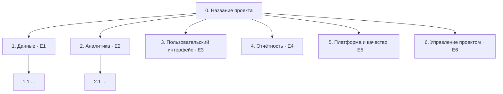

# Иерархическая структура работ (WBS)

<!-- TODO: шаг 3 задания ЛР 2. WBS делит результаты проекта, а не действия. Первый уровень совпадает с эпиками E1–E6. Правило 100%: в WBS есть все работы проекта и ничего лишнего. Пакет работ: 8–80 часов, один ответственный, проверяемый результат. -->

## Диаграмма

## Словарь WBS

Для каждого пакета работ (нижний уровень WBS).

| Код | Пакет работ | Результат | Критерий готовности | Ответственный | Оценка, ч | Эпик / Issues |
|---|---|---|---|---|---|---|
| 1.1 | | | | | | E1, # |
| | | | | | | |
